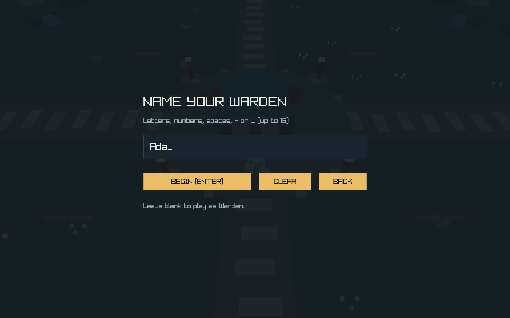
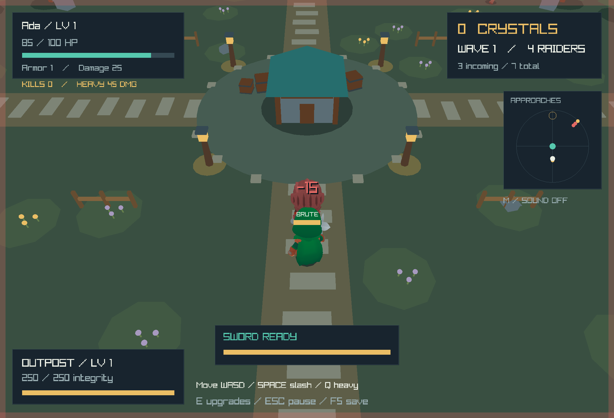
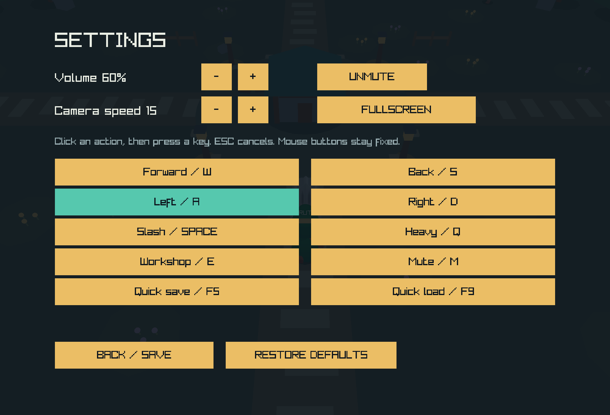

# Outpost

**A Warden's Last Stand** is a low-poly 3D wave-defense game built in Java with Jaylib. Name your warden, defend the outpost, defeat five enemy types, earn crystals, and decide whether to spend them on your character, armor, or base.

[](https://github.com/Chris020606/JavaGame/actions/workflows/build.yml)
[](THIRD_PARTY_NOTICES.md)


## What you can do

- Fight with a directional sword combo and a slower, stronger heavy cleave.
- Read enemy attack telegraphs, dodge arrows and magic, and interrupt melee windups.
- Face raiders, scouts, brutes, archers, and shamans as waves grow to 36 enemies.
- Follow varied arrival routes on the minimap instead of fighting one synchronized blob.
- Earn crystals, upgrade the outpost, improve armor, and increase sword damage.
- See damage numbers, hit flashes, enemy health bars, attack arcs, projectiles, and rewards.
- Name your warden, save and load a defense, remap keys, adjust sound and camera settings, and switch fullscreen mode.


## Download and play

Download a self-contained build from the [GitHub Releases page](https://github.com/Chris020606/JavaGame/releases). Java is included, so players do not need to install Java separately. Extract the complete archive before launching it.

| Platform | Download | Launch |
| --- | --- | --- |
| Windows x64 | `Outpost-windows-x64.zip` | `Outpost/Outpost.exe` |
| macOS Apple Silicon | `Outpost-macos-arm64.tar.gz` | `Outpost.app` |
| macOS Intel | `Outpost-macos-x64.tar.gz` | `Outpost.app` |
| Linux x64 | `Outpost-linux-x64.tar.gz` | `Outpost/bin/Outpost` |

The release workflow builds Windows x64, Linux x64, macOS Intel, and macOS Apple Silicon packages. Native platform support comes from [Jaylib](https://github.com/electronstudio/jaylib#platforms). The packages are unsigned; Windows and macOS may ask you to confirm the first launch. A desktop with OpenGL 3.3 support is required.

## Controls

| Action | Default input |
| --- | --- |
| Move relative to camera | `W A S D` |
| Orbit camera | Hold right mouse button |
| Slash / three-hit combo | `Space` or left click |
| Heavy cleave | `Q` |
| Workshop near the base | `E` |
| Quick save / quick load | `F5` / `F9` |
| Mute sound | `M` |
| Pause / back | `Escape` |
| Confirm name / start / resume | `Enter` |

Attacks land at the animation impact point in a forward arc. Press during the final recovery window to queue the next slash; the third slash is stronger. Heavy cleaves deal 1.8× damage but recover more slowly. Gold numbers show damage dealt, red numbers show health lost after armor, and teal labels show rewards.

## Enemies

| Enemy | Behavior |
| --- | --- |
| Raider | Standard melee fighter |
| Scout | Fast, light, and pursues from farther away |
| Brute | Slow, durable, and hits harder |
| Archer | Keeps distance and fires dodgeable arrows from wave 2 |
| Shaman | Keeps distance and casts slower, stronger magic from wave 3 |

Enemies spread out, flank, and arrive individually along four routes. Red and gold telegraphs show where attacks will land. Move away from the warning or interrupt the enemy with a sword hit. The minimap marks the player in white, the base in teal, and enemies in red/gold.


## Name, saves, and settings

New Game opens a name screen. Names support up to 16 letters, numbers, spaces, `-`, and `_`.



The pause menu can save or load the single save slot. Closing an active defense also saves it. A `.bak` copy is kept before a successful replacement, and invalid or corrupted files leave the current defense untouched.



Settings include effect volume, mute, camera sensitivity, fullscreen/windowed mode, and key remapping. Click an action, press its new key, and Escape to cancel. Duplicate bindings are rejected.



User files are kept outside the installation folder:

- Windows: `%APPDATA%/Outpost/`
- macOS: `~/Library/Application Support/Outpost/`
- Linux: `$XDG_DATA_HOME/outpost/` or `~/.local/share/outpost/`

## Build from source

Use JDK 25 (the CI version) or a newer JDK. Sources target Java 24. The Gradle wrapper is included.

```sh
./gradlew run
./gradlew test
./gradlew inputSmokeTest
./gradlew packageGame
```

On Windows, run `gradlew.bat` or `./gradlew.bat`. The first build downloads dependencies. `packageGame` creates a self-contained app for the current operating system and CPU in `build/native/`; it uses Java's [jpackage](https://docs.oracle.com/en/java/javase/25/docs/specs/man/jpackage.html) to include a runtime. Asset lookup works when the packaged game is launched from another directory.

The tests cover combat geometry, enemy behavior, projectiles, staggered waves, upgrades, save validation/backups, and settings persistence. The desktop smoke test covers name entry, movement, combat, menus, save/load, key remapping, ranged enemies, and window resizing.

## GitHub releases

This repository is [`Chris020606/JavaGame`](https://github.com/Chris020606/JavaGame). The workflow at [`.github/workflows/build.yml`](.github/workflows/build.yml) runs tests and packages all four platforms on pushes, pull requests, and manual runs. Pushing a version tag publishes a release with archives and SHA-256 checksums:

```sh
git add .
git commit -m "Prepare Outpost for public release"
git push origin master
git tag v1.0.0
git push origin v1.0.0
```

The workflow publishes only after every platform build succeeds. Make the GitHub repository public if you want anyone to download the releases.

## Assets and credits

KayKit characters, weapons, and animations are included under CC0 license files. Runtime models are in `resources/outpost/`; rebuild them with `python3 tools/prepare_assets.py`. Rebuild the original synthesized sound effects with `python3 tools/prepare_audio.py`. Both scripts use only the Python standard library.

See [THIRD_PARTY_NOTICES.md](THIRD_PARTY_NOTICES.md) and [`licenses/`](licenses/) for Jaylib, raylib, SDL, JavaCPP, Java runtime, and asset notices.
