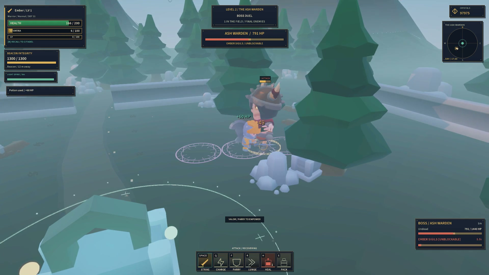
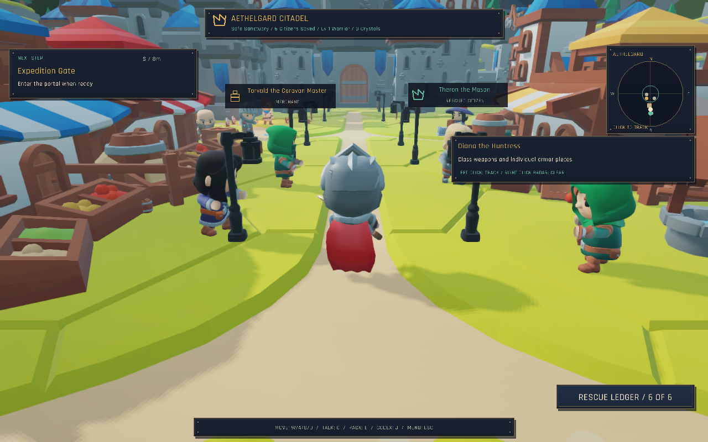
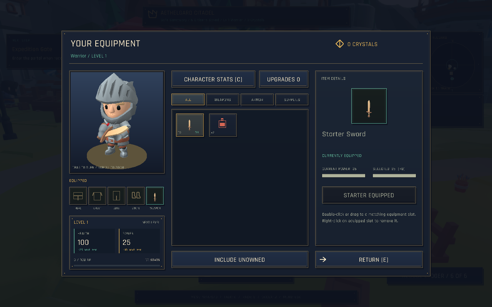
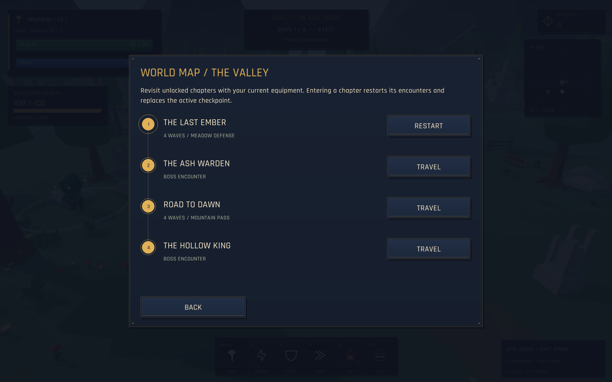

  <strong>A fantasy action RPG for solo adventurers.</strong> 
  Windows · macOS · Linux

  <a href="https://github.com/Chris020606/JavaGame/releases/latest"><strong>Download Outpost</strong></a>
  &nbsp; · &nbsp;
  <a href="https://github.com/Chris020606/JavaGame/releases">Release notes</a>

The gates of Aethelgard are still holding. Six people are stranded beyond them. Choose a Warrior, Archer, or Mage and lead them back to the Beacon before the valley falls.

## Watch The Ash Warden

Face the Ash Warden with sword in hand. Watch 32 seconds of uninterrupted Warrior gameplay in 1080p.

[Download the film](https://github.com/Chris020606/JavaGame/raw/refs/heads/master/docs/media/ash-warden.mp4)

## Your next watch

Walk the streets of Aethelgard, talk with its people, and prepare for the road beyond its gates. Out in the valley, every expedition means defending the Beacon and bringing someone home.

| A city worth returning to | Equipment that changes your build |
| --- | --- |
|  |  |

## Choose your class

| Warrior | Archer | Mage |
| --- | --- | --- |
| Fight up close with sword combos, parries, and heavy strikes. | Keep your distance with a bow, then equip a hand or siege crossbow. | Send spells through enemy ranks and spend mana on powerful casts. |

New solo characters begin in Aethelgard with a story opening and guided training. Meet your class mentor, receive your first weapon, then learn the essentials in the field, including enemy focus with **T**. Choose **Easy, Normal, Hard, or Extreme** when you start your adventure.

## Defend the sanctuary

The wave display tracks enemies in the field and incoming reinforcements. Enemies arrive in waves. Scouts flank, brutes push toward the center, and enemy archers try to keep their distance. Watch their attack warnings, protect the sanctuary, and leave yourself enough room to dodge.

Return to your class mentor in Aethelgard to forge weapons and individual armor pieces. Goran equips Warriors, Lady Elyndra equips Mages, and Diana equips Archers. Mix your gear and compare its power or defense before equipping it.

Torvald sells potions and permanent caravan upgrades in Market Square. Rescue six stranded citizens across the campaign and watch them settle into the city. Select a returned citizen in the rescue ledger and choose **Find in City** to follow their marker through the streets. Boss victories award XP and crystals; new equipment comes from your mentor.

### In the current development build

Enemy archers and hexers telegraph shots at the Beacon and at survivors. Step into the firing line, face the attacker, and parry to earn a riposte. If a survivor falls behind, hold Interact when their rescue card offers the call.

## Follow the northern road

Travel from **Ember Meadow** through the **Ash Cemetery** and **Frozen Pass** to the **Hollow Necropolis**. Face the Ash Warden and Hollow King in dedicated boss chapters. They use rushes, slams, shockwaves, and ground spells; their attacks become more dangerous below half health.

In solo play, the **World Map / Chapters** screen lets you return to unlocked chapters with your current gear. Travelling restarts that chapter and replaces its checkpoint.

## Start playing

Download the archive for your computer from the [latest release](https://github.com/Chris020606/JavaGame/releases/latest), extract the whole folder, and open **Outpost**. Java is included in the desktop downloads.

Music and sound effects have separate volume controls in **Settings**.

On Mac, choose **macOS ARM64** for Apple Silicon or **macOS x64** for Intel. Keep the application and its bundled files together.

<strong>Default controls</strong>

| Action | Control |
| --- | --- |
| Move | W A S D |
| Aim and attack | Left mouse button |
| Attack toward your facing | Space |
| Charge a heavy attack | Hold Q, then release |
| Parry | F |
| Lunge | R |
| Dodge / sprint | Ctrl / Shift |
| Heal with a potion | H |
| Interact / sanctuary blessing | G |
| Focus an enemy | T |
| Inventory | E |
| Character stats inside inventory | C |
| Recall to city between fights | B |
| Craft equipment | Talk to your class mentor in the city |
| Orbit the camera | Hold right mouse button |
| Pause | Esc |

Controls can be changed in Settings. The sanctuary's marked ring restores health. Stand between an enemy archer and the beacon or a survivor, face the incoming shot, and time a parry to intercept it and ready a riposte. When the beacon takes a hit, its marker pulses red on the radar. Press G inside the ring to repair up to 100 integrity for 30 crystals. Smaller repairs cost proportionally less.

<strong>What's new in v4.5.0</strong>

- A living title scene with drifting clouds, snowy peaks, a river valley, and a day–night sky you can move.
- Clearer conversations with clickable **Talk** prompts throughout Aethelgard.
- More dangerous boss patterns with readable warnings and room to dodge.
- Rescue opportunities that remain available after the fighting ends.
- Clearer equipment comparisons, an upgrades filter, and city destinations you can track from the radar.
- Separate music and effects controls, cleaner combat rewards, and clearer wave progress.
- A focused single-player adventure; multiplayer has been removed.

[Read the full update notes](docs/releases/v4.5.0.md).

---

Characters and animation by **KayKit**. Scenery by **Kenney**. [Full credits](THIRD_PARTY_NOTICES.md).
