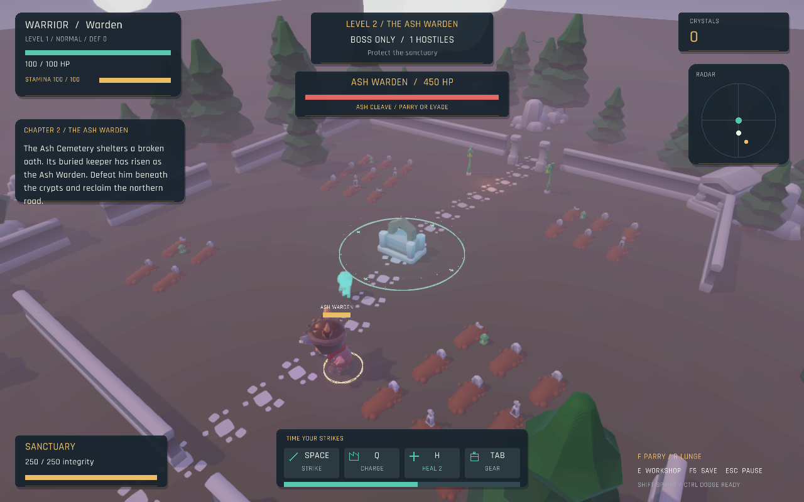
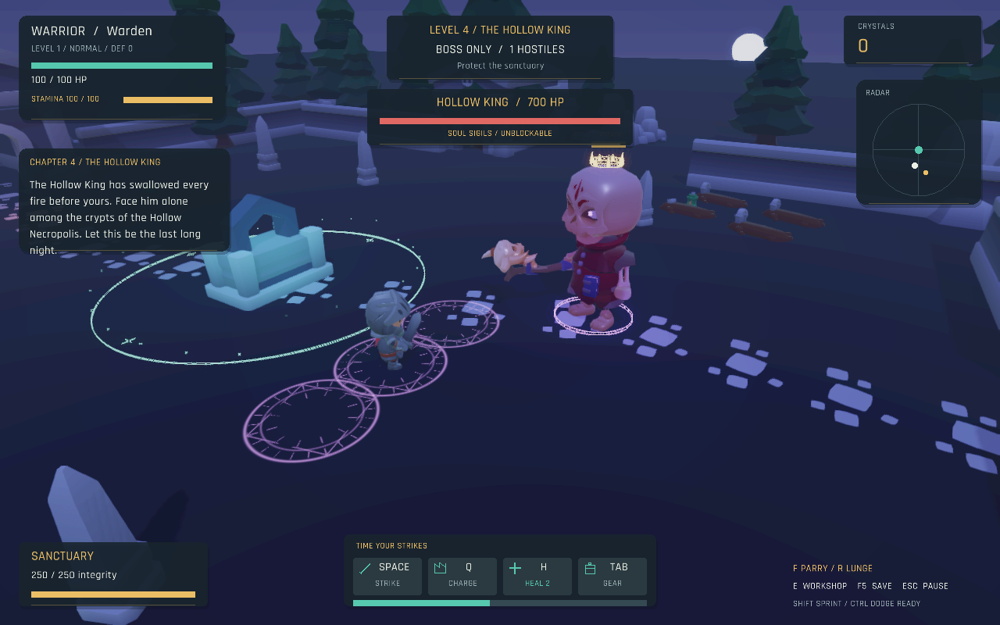
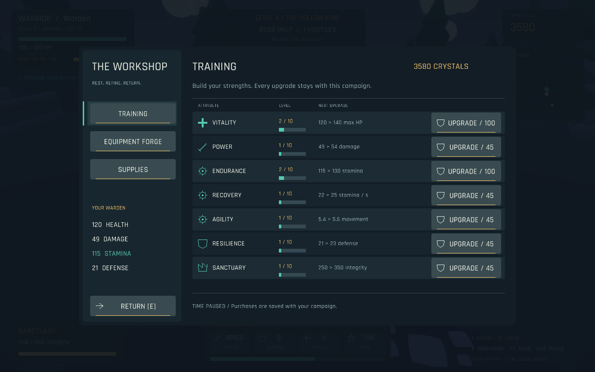

# Outpost

**Outpost** is a 3D action and wave-defense game about the last warden of a dying valley. Protect the sanctuary, master stamina-based combat, build your character, and carry the last ember through a four-chapter campaign.

**Current source version: 1.8.0.** The latest published download is **v1.2.0** and contains the older game. The features and screenshots below describe the current source. Build it locally or get packages from a successful [desktop build workflow](https://github.com/Chris020606/JavaGame/actions/workflows/build.yml).



## The campaign

| Chapter | Environment and encounters | Objective |
| --- | --- | --- |
| The Last Ember | Meadow expedition camp; four waves of human raiders | Wake the sanctuary beacon |
| The Ash Warden | Cemetery, graves, crypts; one skeletal boss | Reclaim the northern road |
| Road to Dawn | Snowy mountain pass; four waves of skeleton squads | Protect the refugee caravan |
| The Hollow King | Moonlit necropolis; one final skeleton boss | Bring morning back to the valley |

Each chapter changes its scenery, sky, lighting, fog, and enemy roster. Authored landmarks, winding routes, clustered vegetation, varied burial plots, broken walls, and uneven mountain outcrops replace repeated rings of props. Distant groves, clouds, birds, snowfall, and fire embers frame the arena. Scenery remains decorative; the hero stays inside the playable boundary.

The HUD tracks the active chapter, waves left, queued enemies, health, stamina, sanctuary integrity, resources, and enemy arrivals. Read the Chronicle for the story, save between chapters, and continue to the final ending. Boss chapters contain exactly one boss.

## Combat and enemies

- **Warrior, Archer, Mage:** distinct animated characters with melee combos, arrows/crossbows, or piercing magic. Each has a charged heavy attack.
- **Stamina and timing:** sprint, directional dodge, late-input attack chains, charged heavies, forward lunges, directional parries, and a rewarded riposte. Dodge invulnerability covers only part of its animation.
- **Tactical squads:** scouts flank, melee enemies recover and coordinate attacks, brutes press forward, ranged enemies retreat/strafe and lead moving targets, and shamans or frost hexers heal wounded allies through interruptible channels.
- **Four difficulties:** Easy, Normal, Hard, Extreme change strength, speed, numbers, attack cadence, and melee squad pressure. The choice persists with each campaign.
- **Skeletal bosses:** the Ash Warden and Hollow King use committed cleaves, rushes, ground slams, expanding shockwaves, delayed sigils, and enraged phases.
- **Readable effects:** glowing weapon ribbons, textured spell seals, impact sparks, healing wisps, physical arrowheads, and trailing magic replace plain attack wireframes. Gold boss attacks can be parried; red/purple attacks must be evaded. Effects preserve the underlying damage areas and timing.



Filtered shadows, material lighting, bloom, anti-aliasing, and native-DPI UI support High and Balanced graphics modes. A pulsing six-unit sanctuary ring shows where healing is active.

## Build your warden

Spend crystals at the sanctuary workshop. Its sidebar separates **Training**, **Equipment Forge**, and **Supplies**. Aligned training rows compare current values, next improvements, levels, and costs; the sidebar keeps your main stats visible.

| Training track | Benefit per purchase |
| --- | --- |
| Vitality | +20 maximum/current HP |
| Power | +5 damage |
| Endurance | +15 maximum stamina |
| Recovery | +3 stamina regenerated per second |
| Agility | +4% of starting class movement speed |
| Resilience | +2 damage reduction |
| Sanctuary | +100 integrity and full repair |



Forge three weapon tiers and Iron, Runic, or Dawnsteel armor. Equipped items visibly follow the animated player: swords, a longsword, waraxe, Dawnblade, bows/crossbows, wands, and staves; helmets, chest/shoulder armor, greaves, and boots. Boss rewards also unlock weapon tiers.

Open the inventory for a **rotatable 3D player preview**, an equipment grid, owned/locked markers, stat comparisons, and potion storage. Click gear to equip it, drag it into its matching slot, or right-click equipped armor to remove it. The inventory and workshop pause combat. Potions restore up to 60 HP; carry five and restock at the workshop.


## Instant playtest — no grinding

Choose **PLAYTEST / ALL GEAR** on the title screen. Select any class, difficulty, and chapter, then start with all weapons and armor unlocked, a full Dawnsteel set equipped, five potions, 100,000 crystals, full health/stamina, and maxed training. Switch Training to starter stats if you want to test upgrades or combat balance. The inventory opens immediately so you can try equipment.

**Pause → Playtest Tools** changes class/chapter or resets the complete kit. **Load Playtest** resumes the separate `playtest-save.properties` slot; the regular campaign save is preserved. Save/load shortcuts use the active mode's slot.

To launch directly from source: `./gradlew run --args=--playtest`. A packaged launcher also accepts `--playtest`.

## Music and sound

An original stereo soundtrack has separate title, meadow, cemetery, frozen-pass, and necropolis themes. A synchronized percussion layer fades in during combat. Scene transitions crossfade; music continues through paused menus while combat intensity fades out.

Layered weapon swings, varied metal impacts, bow releases, magic casts, parries, dodges, boss slams, healing wards, and upgrade chimes replace the earlier short tones. Master audio volume and mute control both music and effects. The game also runs when no audio device is available. The score and effects are generated reproducibly by [prepare_audio.py](https://github.com/Chris020606/JavaGame/blob/master/tools/prepare_audio.py), without external recordings or samples.

## Controls

| Action | Default input |
| --- | --- |
| Move | W A S D |
| Sprint / dodge | Left Shift / Left Ctrl |
| Orbit camera | Hold right mouse button |
| Light attack | Space / left mouse button |
| Charged heavy | Hold and release Q |
| Parry / lunge | F / R |
| Inventory / potion | Tab / H |
| Workshop near sanctuary | E |
| Save / load | F5 / F9 |
| Mute / pause | M / Escape |
| Confirm / continue | Enter |

Keyboard bindings, camera sensitivity, audio, fullscreen, and graphics quality are configurable. Saves retain the campaign, difficulty, class, upgrades, equipment, stamina, living enemies, and queued arrivals. Older saves migrate with defaults for newer features.

## Downloads and version history

The [latest published release, v1.2.0](https://github.com/Chris020606/JavaGame/releases/tag/v1.2.0), includes these standalone packages with Java bundled:

| Platform | File |
| --- | --- |
| Windows x64 | Outpost-windows-x64.zip |
| macOS Apple Silicon | Outpost-macos-arm64.tar.gz |
| macOS Intel | Outpost-macos-x64.tar.gz |
| Linux x64 | Outpost-linux-x64.tar.gz |

Extract the archive and keep its folders together. These packages are unsigned. The matching `.sha256` files are available on the release page. For current features, build the source below or use the artifacts from a successful workflow run; a source push does not create a tagged release.

| Version | Availability | Main additions |
| --- | --- | --- |
| 1.8.0 | Current source | All-unlocked playtest, class/chapter selector, starter/max training and separate save |
| [1.7.0](https://github.com/Chris020606/JavaGame/commit/0d2c25f) | Source update | Natural scenery composition, redesigned workshop, chapter soundtrack, layered Foley, textured combat effects |
| [1.6.0](https://github.com/Chris020606/JavaGame/commit/3cdadad) | Source update | Tactical AI, four difficulties, chapter biomes, training/forge, modular armor and preview inventory |
| [1.5.0](https://github.com/Chris020606/JavaGame/commit/f5908ed) | Source update | Combat discipline, skeletal bosses, modern lighting and post-processing |
| [1.4.0](https://github.com/Chris020606/JavaGame/commit/bbad0ff) | Source update | Four-chapter story, boss-only levels, sprint/dodge, living sky, healing indicators |
| [1.3.0](https://github.com/Chris020606/JavaGame/commit/16c4539) | Source update | Imported Kenney environments, bow correction, redesigned HUD |
| [1.2.0](https://github.com/Chris020606/JavaGame/releases/tag/v1.2.0) | Published packages | Warlords and weapon loot |
| [1.1.0](https://github.com/Chris020606/JavaGame/releases/tag/v1.1.0) | Published packages | Hero classes, potions, inventory |
| [1.0.3](https://github.com/Chris020606/JavaGame/releases/tag/v1.0.3) | Published packages | Earlier standalone desktop release |

## Build and test

Install **JDK 25 or newer** and run:

```sh
git clone https://github.com/Chris020606/JavaGame.git
cd JavaGame
./gradlew run
```

On Windows use `gradlew.bat`. The first build downloads dependencies. Other useful commands:

```sh
./gradlew test
./gradlew inputSmokeTest
./gradlew inputSmokeTest --args=--standard-dpi
./gradlew packageGame
```

Desktop smoke tests require a graphical session and use an isolated temporary profile. Native packaging uses `jpackage`, embeds Java, and builds for the host platform. CI builds Windows x64, Linux x64, and both macOS architectures. Look in `build/native` for a locally packaged application.

See [GAME_GUIDE.md](GAME_GUIDE.md) for detailed rules, [DEVELOPMENT_NOTES.md](DEVELOPMENT_NOTES.md) for progress and next steps, and [THIRD_PARTY_NOTICES.md](THIRD_PARTY_NOTICES.md) for licenses. Characters, animation, and most weapons use CC0 KayKit packs; scenery uses Kenney Nature Kit and Graveyard Kit. Modular equipment, Dawn weapons, effect textures, music, and Foley were created for this project.
