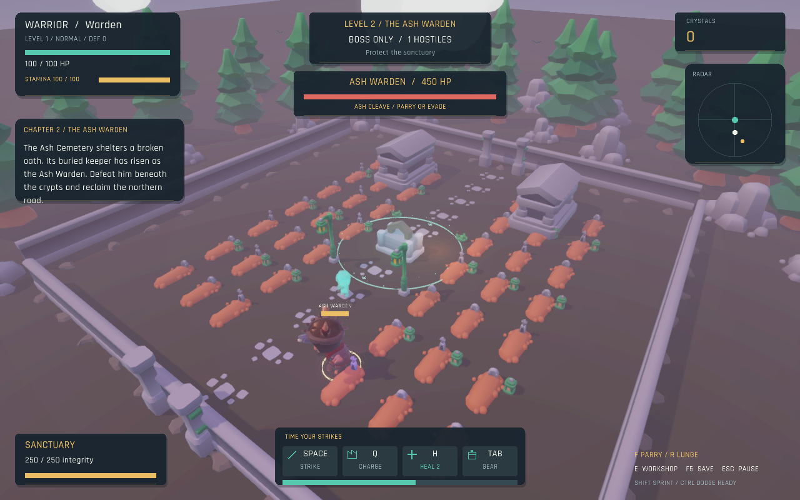
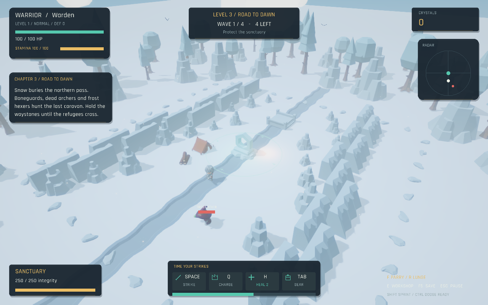
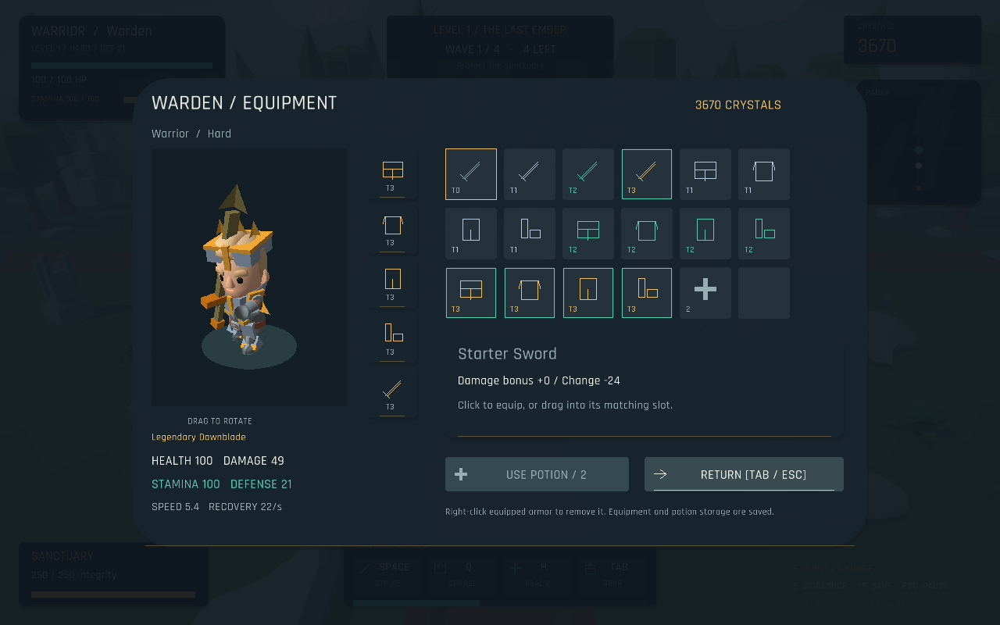

# Outpost



**Outpost** is a small 3D wave-defense game about a warden protecting a frontier settlement. Fight through increasingly dangerous raids, collect crystals, and improve your hero and outpost before the next attack arrives.

See [GAME_GUIDE.md](GAME_GUIDE.md) for the complete player and developer guide, and [DEVELOPMENT_NOTES.md](DEVELOPMENT_NOTES.md) for future work.

## Features

- Choose Warrior, Archer, or Mage with distinct animated models and a sword, bow, or staff.
- Play The Last Ember: a four-chapter story campaign with two four-wave sieges and two boss-only duels.
- Track waves left, read the Chronicle, and save progress between chapters.
- Sprint and dodge with animated movement; chain three warrior sword swings and a jumping heavy cleave.
- Explore a bounded clearing framed by distant forest, sky, drifting clouds, birds, and campfire embers.
- Find healing inside the glowing, six-unit sanctuary ring.
- Filtered cast shadows, material lighting, bloom, anti-aliasing, and a native-DPI combat HUD.
- Stamina management, timed attack chains, charged heavies, parry/riposte, and lunging strikes.
- Towering skeletal bosses with slams, rushes, sigils, and enraged phases.
- Easy, Normal, Hard, and Extreme campaigns with coordinated enemy squads.
- Four distinct chapter environments: meadow, cemetery, snowy pass, and necropolis.
- Skeleton squads with flanking scouts, retreating archers, and allied-healing hexers.
- Independent health, damage, stamina, recovery, speed, defense, and sanctuary training.
- A drag-and-drop equipment grid with a rotatable 3D hero preview.
- Visible swords, axe, bows/crossbows, staves, and four modular armor slots.
- Boss-only duels against the Ash Warden and Hollow King, with crystal rewards and weapon loot.
- Directional sword attacks with a three-hit combo and a heavy cleave.
- Six enemy types with different strengths and attack styles.
- Archers and shamans that attack from a distance.
- Enemy attack warnings, floating damage numbers, health bars, and a minimap.
- A decorated low-poly map with paths, trees, lanterns, fences, rocks, and flowers.
- Sound effects, a name screen, save/load, and customizable controls.





## Download and install

Open the [Releases page](https://github.com/Chris020606/JavaGame/releases) and download the file for your computer:

| Computer | File |
| --- | --- |
| Windows 64-bit | `Outpost-windows-x64.zip` |
| Mac with Apple Silicon | `Outpost-macos-arm64.tar.gz` |
| Mac with Intel processor | `Outpost-macos-x64.tar.gz` |
| Linux 64-bit | `Outpost-linux-x64.tar.gz` |

Extract the downloaded file somewhere on your computer. Keep the folders inside the archive together, then launch the Outpost application inside the extracted folder. Java is already included, so you do not need to install it separately.

On Windows or macOS, the first launch may show a security confirmation because the game is not digitally signed. Choose the option to open it if you downloaded it from the project’s GitHub Releases page. Linux requires a normal desktop session with working graphics and audio support.

## Controls

| Action | Key |
| --- | --- |
| Move | `W A S D` |
| Sprint / dodge | `Left Shift` / `Left Ctrl` |
| Orbit the camera | Hold the right mouse button |
| Sword combo | `Space` or left click |
| Charged heavy attack | Hold / release `Q` |
| Parry / lunge | `F` / `R` |
| Inventory / use potion | `Tab` / `H` |
| Open the workshop | `E` near the outpost |
| Save / load | `F5` / `F9` |
| Mute sound | `M` |
| Pause or go back | `Escape` |
| Confirm a choice | `Enter` |

Choose your class on the name screen before beginning. Face an enemy before attacking. Arrows stop at the first enemy; magic bolts pierce enemies. Each class has a stronger charged attack on Q. Attacks, sprinting, and dodging consume stamina; watch the gold meter. Face an incoming gold attack and tap F just before impact to parry, then counterattack for a riposte. Red and purple boss areas must be evaded.

 Sword swings hit in the direction your warden is facing. Press again near the end of a swing to continue the combo. The third attack is stronger, while the heavy cleave does more damage but takes longer to recover.

## Enemies

Each wave sends enemies toward the outpost at different times, so you can choose which threat to handle first.

- **Raiders** are the standard melee enemy.
- **Scouts** move quickly and chase you from farther away.
- **Brutes** are slow, tough, and hit hard.
- **Archers** keep their distance and fire arrows.
- **Shamans** cast powerful magic from a safe range.
- **Warlords** guard chapters 2 and 4 in boss-only duels and resist interruption. Defeat them for 120 crystals and the next weapon tier, then equip it with `Tab`.

Red and gold warnings show where an enemy is about to attack. Step away from the warning or interrupt the enemy with your sword. Gold numbers show damage you deal, red numbers show damage you take, and teal text shows rewards.

## Upgrades

Defeated enemies drop crystals. Spend them at the workshop near the outpost:

- **Outpost:** increases its maximum integrity and repairs it completely.
- **Training:** improve health, damage, stamina capacity/recovery, movement, and damage reduction independently.
- **Equipment Forge:** unlock visible weapon upgrades and Iron, Runic, or Dawnsteel armor sets.
- **Supplies:** restock healing potions.

Stay near the outpost when you need to recover. The safe area heals your warden over time.

## Playing from the source code

If you want to run the project from source, install JDK 25 or newer, clone the repository, and run the Gradle wrapper from the project folder:

```sh
git clone https://github.com/Chris020606/JavaGame.git
cd JavaGame
./gradlew run
```

On Windows, use `gradlew.bat run` instead. The first run downloads the required dependencies. To run the checks used by the project, use `./gradlew test`.

## Credits

The character, weapon, and animation assets come from KayKit and are included under their CC0 license. Environment trees, rocks, plants, tents, and ruin props come from Kenney’s CC0 Nature Kit. The outpost and sound effects were made for this project.

See [THIRD_PARTY_NOTICES.md](THIRD_PARTY_NOTICES.md) for the licenses of the game engine and included assets.

Have fun defending the outpost.
