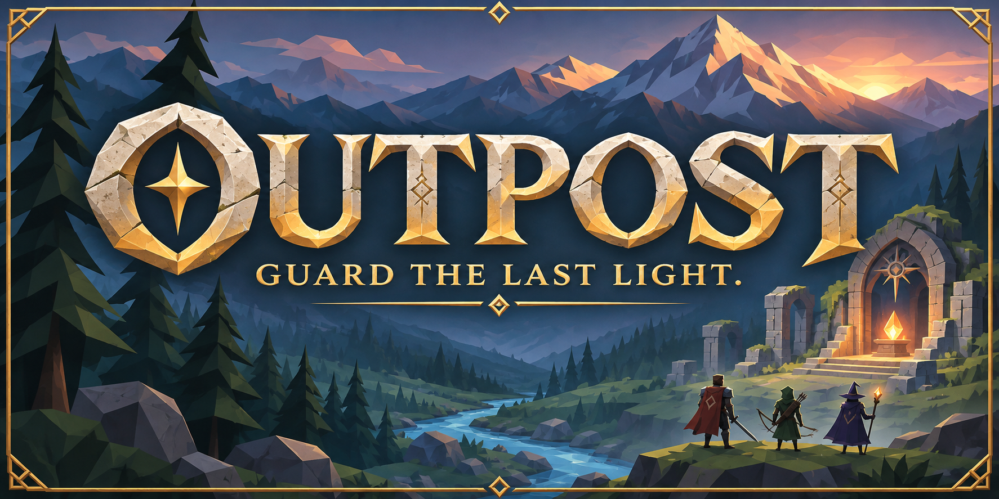
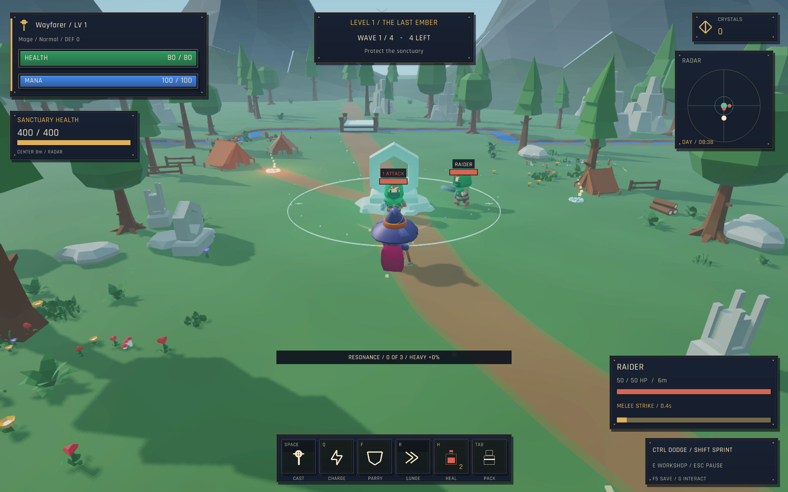
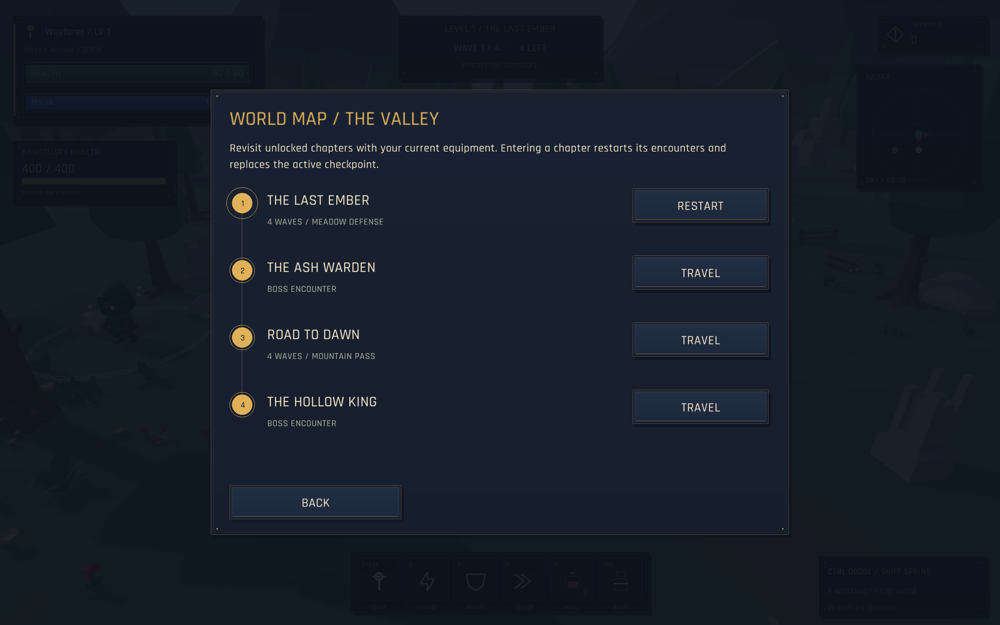
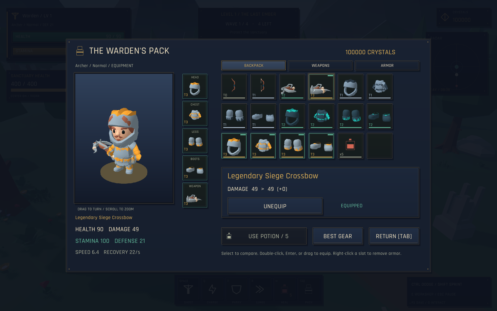

  <strong>A fantasy action RPG for one or two players.</strong> 
  Windows · macOS · Linux

  <a href="https://github.com/Chris020606/JavaGame/releases/tag/v4.3.0"><strong>Download Outpost</strong></a>
  &nbsp; · &nbsp;
  <a href="#play-with-a-friend">Play with a friend</a>
  &nbsp; · &nbsp;
  <a href="https://github.com/Chris020606/JavaGame/releases">Release notes</a>

The sanctuary is the valley's last source of light. Defend it from raiders and the restless dead, earn better equipment, and face the Ash Warden and the Hollow King.

Choose a Warrior, Archer, or Mage. Play the four-chapter campaign alone, or share the defense with a friend in two-player co-op.

## Choose your class

| Warrior | Archer | Mage |
| --- | --- | --- |
| Fight up close with sword combos, parries, and heavy strikes. | Keep your distance with a bow, then equip a hand or siege crossbow. | Send spells through enemy ranks and spend mana on powerful casts. |

New characters begin with a hands-on tutorial. Choose **Easy, Normal, Hard, or Extreme** when you start your adventure.

## Defend the sanctuary

Enemies arrive in waves. Scouts flank, brutes push toward the center, and enemy archers try to keep their distance. Watch their attack warnings, protect the sanctuary, and leave yourself enough room to dodge.

Between fights, spend crystals on your character and forge new equipment. Mix armor pieces, compare weapon stats, and see each change on your hero. Optional supply caches, survivors, and waystones offer extra rewards if you can spare the time to help.

## Follow the northern road

Travel from **Ember Meadow** through the **Ash Cemetery** and **Frozen Pass** to the **Hollow Necropolis**. Face the Ash Warden and Hollow King in dedicated boss chapters. They use rushes, slams, shockwaves, and ground spells; their attacks become more dangerous below half health.

In solo play, the **World Map / Chapters** screen lets you return to unlocked chapters with your current gear. Travelling restarts that chapter and replaces its checkpoint.

| Plan your next chapter | Equip your warden |
| --- | --- |
|  |  |

## Play with a friend

Co-op is for **two players on the same Wi-Fi/LAN or a private VPN**. Both players need the same game version. Public matchmaking is not available.

1. Choose **Play Together**. One player selects **Host New Game**.
2. Send the lobby invite to your friend.
3. Your friend selects **Paste Invite**, then **Join Session**.
4. Choose your upgrades and both press **Ready**.

You share one sanctuary, with encounters scaled for two players. Revive a fallen partner by holding **G** nearby. Mage heavy bolts can heal a teammate or repair the sanctuary. Co-op has its own checkpoint, so your solo adventure stays separate.

If a connection fails, allow the host through the firewall on **TCP 27878**. Hosts with several network addresses can use **Next Address** to select the one their friend can reach.

## Start playing

Download the archive for your computer from the [latest release](https://github.com/Chris020606/JavaGame/releases/latest), extract the whole folder, and open **Outpost**. Java is included in the desktop downloads.

On Mac, choose **macOS ARM64** for Apple Silicon or **macOS x64** for Intel. Keep the application and its bundled files together.

<strong>Default controls</strong>

| Action | Control |
| --- | --- |
| Move | W A S D |
| Aim and attack | Left mouse button |
| Attack toward your facing | Space |
| Charge a heavy attack | Hold Q, then release |
| Parry | F |
| Lunge | R |
| Dodge / sprint | Ctrl / Shift |
| Heal with a potion | H |
| Interact / sanctuary blessing | G |
| Focus an enemy | T |
| Inventory / workshop | Tab / E |
| Orbit the camera | Hold right mouse button |
| Pause | Esc |

Controls can be changed in Settings. The sanctuary's marked ring restores health. In solo play, press G there to spend crystals repairing it; in co-op, hold G there to spend a potion on repairs.

<strong>What's new in v4.3</strong>

- Focus enemies and read their health, distance, and attack timer in solo or co-op.
- Revisit unlocked solo chapters from the world map.
- Find new meadow and cemetery landmarks along a more distinct highland road.
- Trees fade when they hide your hero, and campfire embers follow the campsite.

[Read the release notes and download v4.3](https://github.com/Chris020606/JavaGame/releases/tag/v4.3.0).

---

Characters and animation by **KayKit**. Scenery by **Kenney**. [Full credits](THIRD_PARTY_NOTICES.md).

For source builds and development, see the [maintenance handbook](docs/development/README.md) and [contribution guide](CONTRIBUTING.md).
