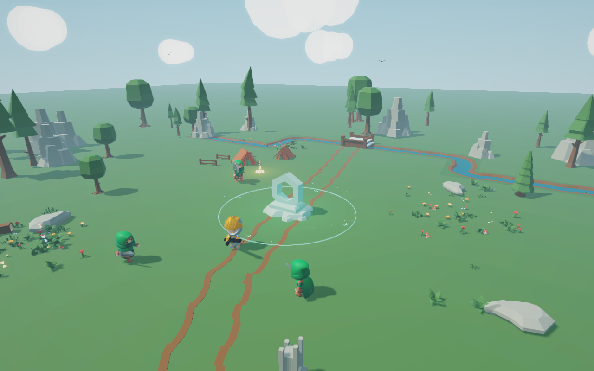
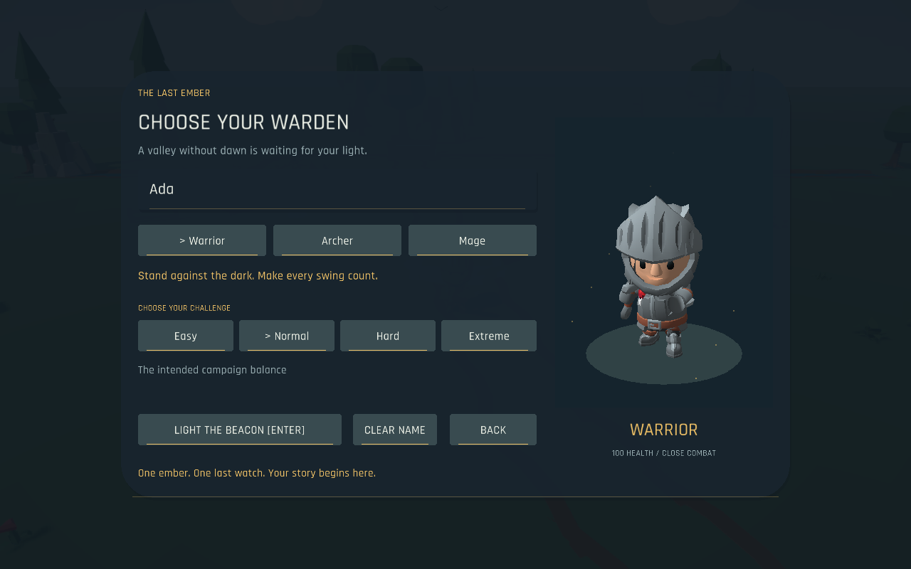
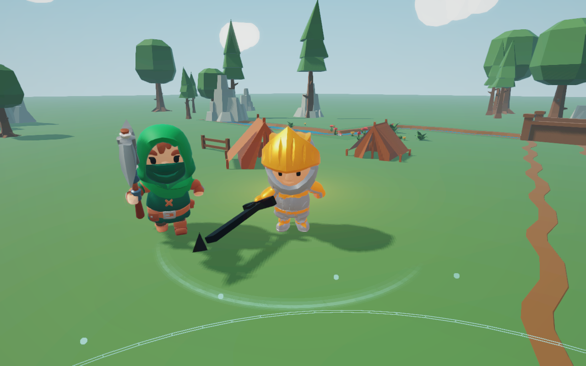
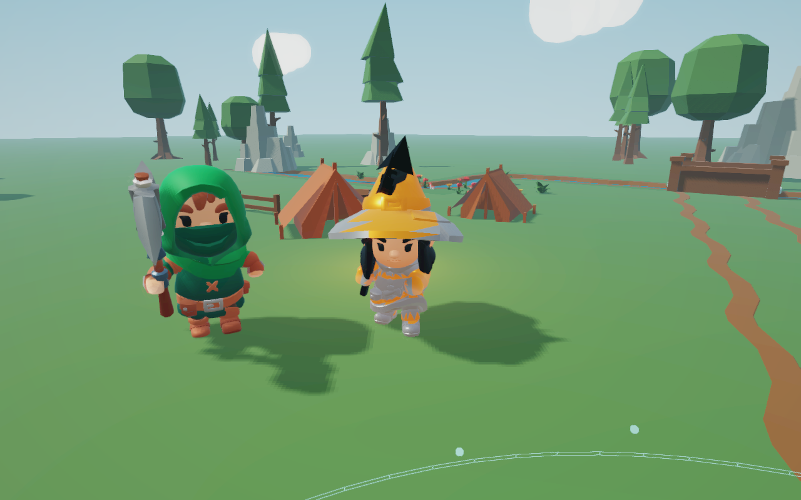

# Outpost

**Guard the last light. Bring back the dawn.**

The valley's fires have gone cold. One ember still burns beneath a forgotten sanctuary—and you're its last warden. Choose your hero, hold back the raids, and follow the light through a four-chapter adventure.

## Who will carry the ember?

- **Warrior:** get close, chain sword swings, parry a strike, and answer with a powerful counterattack.
- **Archer:** keep your distance, pick your openings, and trade your bow for a crossbow as your equipment improves.
- **Mage:** send piercing spells through enemies and unleash a charged surge when the crowd closes in.

Name your warden, choose **Easy, Normal, Hard, or Extreme**, and light the beacon. The difficulty stays with your adventure.

## Every swing matters

Watch your stamina. Sprint to reach a threatened gate, dodge through danger, or save enough strength for a heavy attack. Time your next light strike to continue a combo. A well-timed parry opens the way for a stronger riposte.

Enemies have plans of their own: scouts flank, brutes push forward, archers retreat and reposition, and spellcasters can heal wounded allies. Read their attack warnings and interrupt them before they finish.

**Gold boss attacks can be parried. Red and purple attacks must be evaded.**

## Four places. One last fire.

Your journey starts in a meadow camp among wildflowers, fallen logs, and a winding stream. Beyond it lie the **Ash Cemetery**, the **Frozen Pass**, and the **Hollow Necropolis**.

Hold the sanctuary through two four-wave sieges, then face the **Ash Warden** and **Hollow King** in their own boss-only chapters. Slams, rushes, expanding shockwaves, and delayed spell seals keep those duels moving. Below half health, the bosses become more dangerous.

The HUD tells you how many waves remain. Chapter endings give you a moment to read the story, change equipment, and prepare for what comes next. The Chronicle keeps the valley's story close at hand.

## Make the warden your own

Earn crystals from defeated enemies and spend them at the sanctuary workshop. Improve **health, damage, stamina, recovery, speed, defense, and sanctuary strength** separately.

Forge **Iron, Runic, and Dawnsteel armor**, then mix helmets, chest armor, greaves, and boots. Equipment visibly fits each class: a full Warrior helm, an open-faced Archer helmet, and an armored Mage hat. Change your sword, longsword, axe, bow, crossbow, wand, or staff and see it on your hero.

Open your inventory for a rotatable character preview. Click an item to equip it, drag it into its slot, or right-click armor to remove it. Combat pauses while you choose.

Need to recover? Step inside the sanctuary's glowing healing ring. Keep potions handy for fights farther from home; you can carry five and restock at the workshop.

## Try everything without grinding

Choose **PLAYTEST / ALL GEAR** on the title screen to start with:

- Every weapon and armor tier unlocked.
- Dawnsteel equipped, five potions, and 100,000 crystals.
- Any class, difficulty, or chapter—including either boss duel.
- Maxed upgrades, or starter stats if you'd rather experiment with your build.

The inventory opens immediately. **Pause → Playtest Tools** lets you switch class/chapter or reset your kit. The playtest has its own save, so your campaign stays safe.

## Pick up and play

| Action | Default input |
| --- | --- |
| Move | W A S D |
| Light attack | Space or left click |
| Charged heavy | Hold and release Q |
| Sprint / dodge | Left Shift / Left Ctrl |
| Parry / lunge | F / R |
| Inventory / potion | Tab / H |
| Workshop near the sanctuary | E |
| Orbit the camera | Hold right mouse button |
| Pause / mute | Escape / M |
| Save / load | F5 / F9 |

Keyboard controls can be changed in Settings. Your adventure saves your chapter, difficulty, upgrades, equipment, and enemies still to come. Each location has its own music, with percussion that rises during battle.

## Play Outpost

[**Download a published release**](https://github.com/Chris020606/JavaGame/releases)

Choose the archive for your computer: Windows, macOS Apple Silicon, macOS Intel, or Linux. Extract it, keep its folders together, and launch Outpost. Java is included.

**Published downloads currently contain v1.2.0.** The newer features and actual in-game screenshots on this page show the latest development version, **v1.9.0**. For that version, follow the [current-version instructions in the game guide](GAME_GUIDE.md#build-test-and-release). Packages are also available from successful [development builds](https://github.com/Chris020606/JavaGame/actions/workflows/build.yml).

What's changed?

- **1.9:** fitted armor for every class, restored Warrior swing animations, a livelier meadow, animated hero selection, and a refreshed player guide.
- **1.8:** instant all-gear playtest with class/chapter selection and a separate save.
- **1.7:** chapter music, richer sound effects, redesigned workshop, natural scenery layouts, and new attack effects.
- **1.6:** smarter squads, four difficulties, distinct chapter environments, armor, and an equipment preview.
- **1.5:** timed combat, skeletal bosses, and upgraded lighting.
- **1.4:** four-chapter story, boss-only levels, sprinting, dodging, and a living sky.
- **1.3:** imported environment models and a new HUD.
- [**1.2 — Warlords and Weapon Loot**](https://github.com/Chris020606/JavaGame/releases/tag/v1.2.0): published desktop downloads.
- [**1.1 — Heroes and Inventory**](https://github.com/Chris020606/JavaGame/releases/tag/v1.1.0): published desktop downloads.
- [**1.0.3**](https://github.com/Chris020606/JavaGame/releases/tag/v1.0.3): earlier desktop release.

Versions 1.3–1.9 are development updates rather than published releases.

For detailed rules and controls, see the [game guide](GAME_GUIDE.md). Characters and animation are by KayKit; scenery is by Kenney. Music and sound were created for Outpost. Full credits are in [THIRD_PARTY_NOTICES.md](THIRD_PARTY_NOTICES.md).
