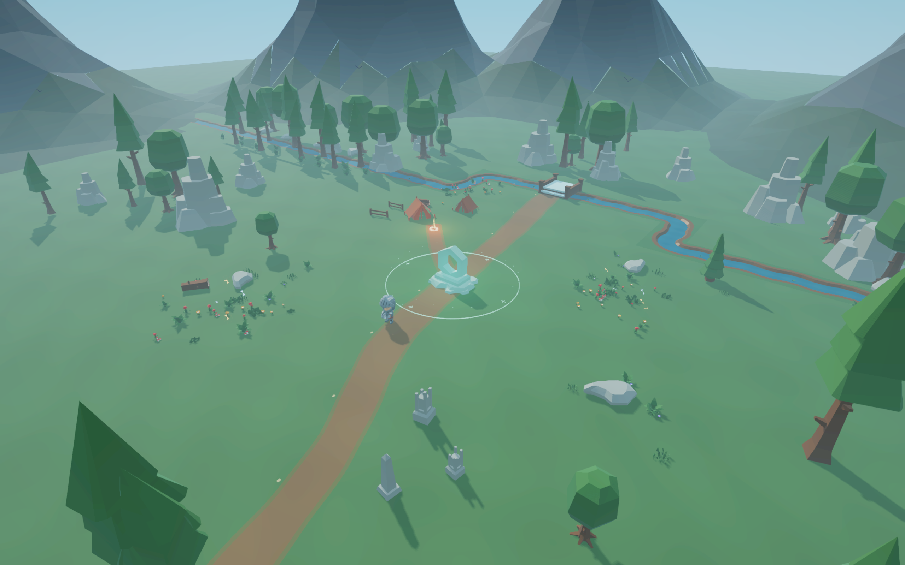
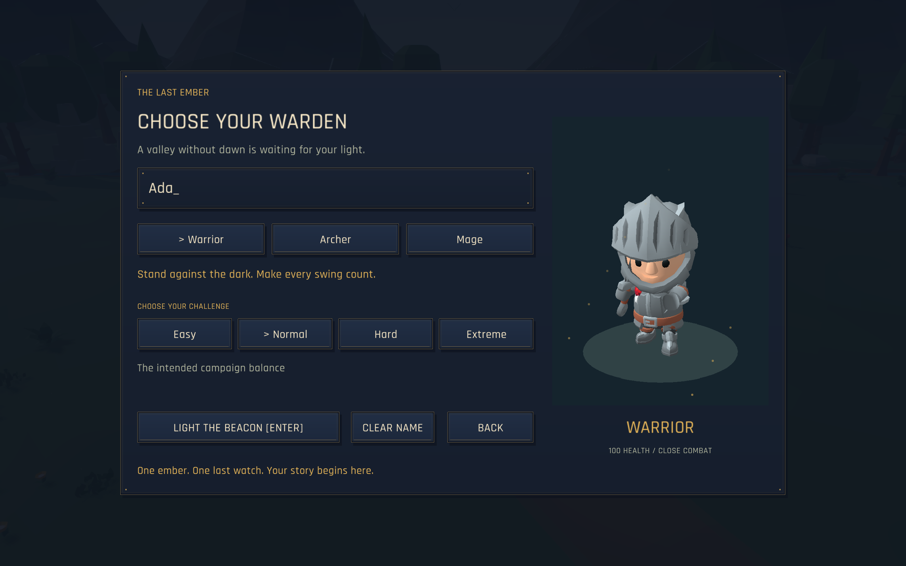
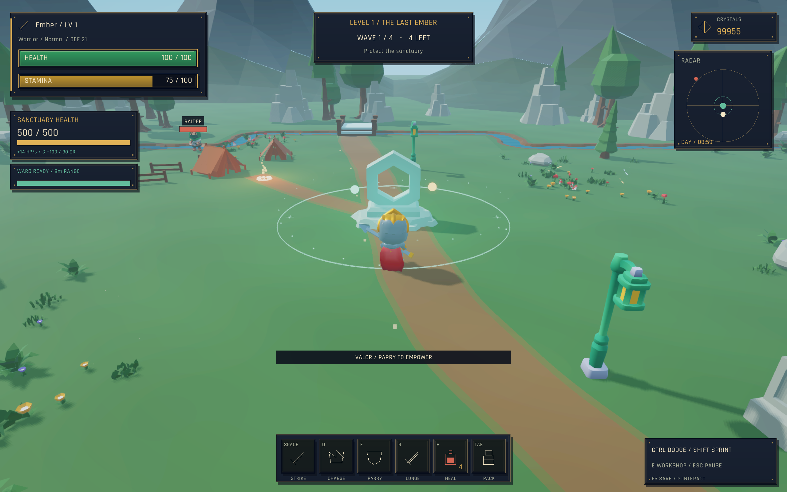
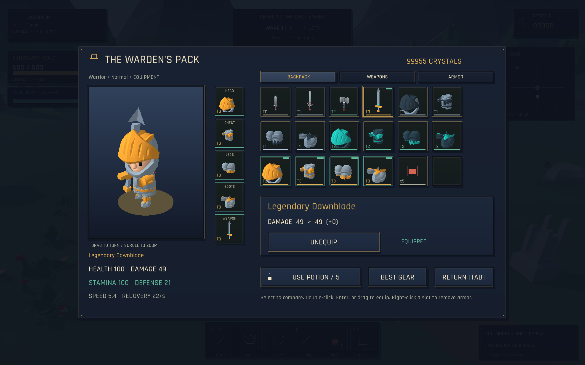
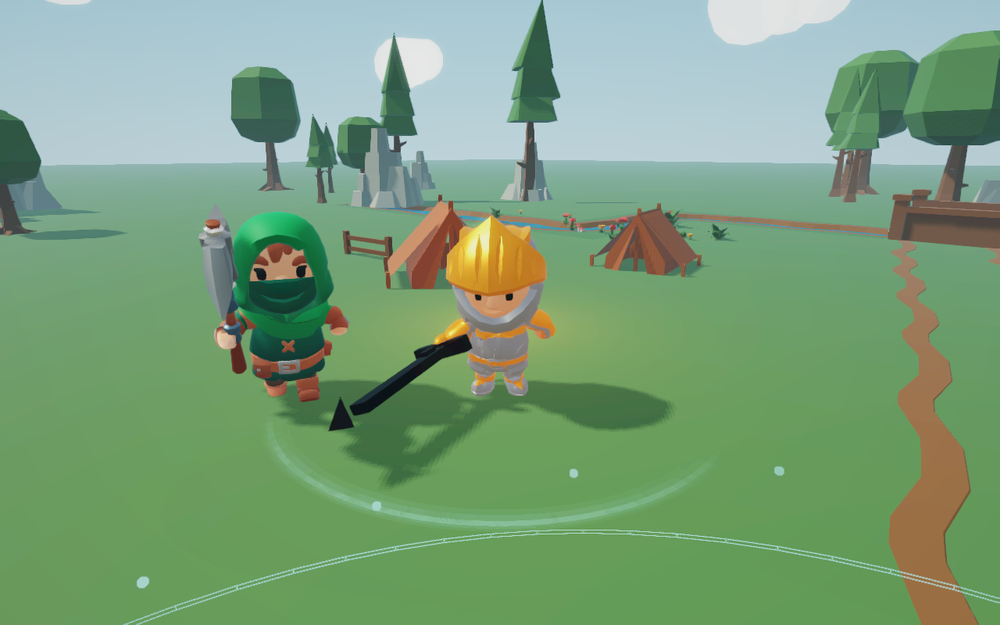
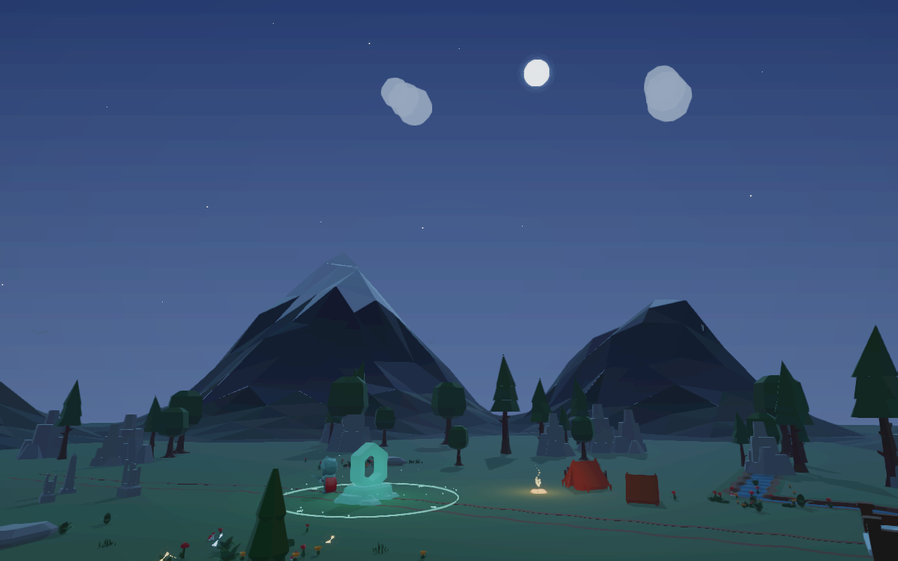
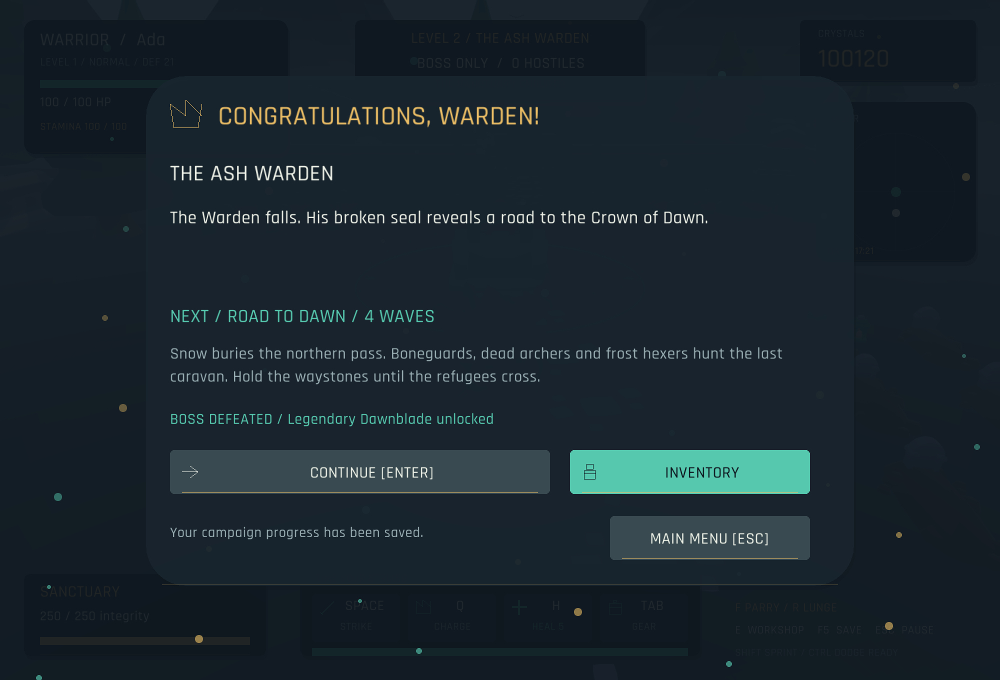
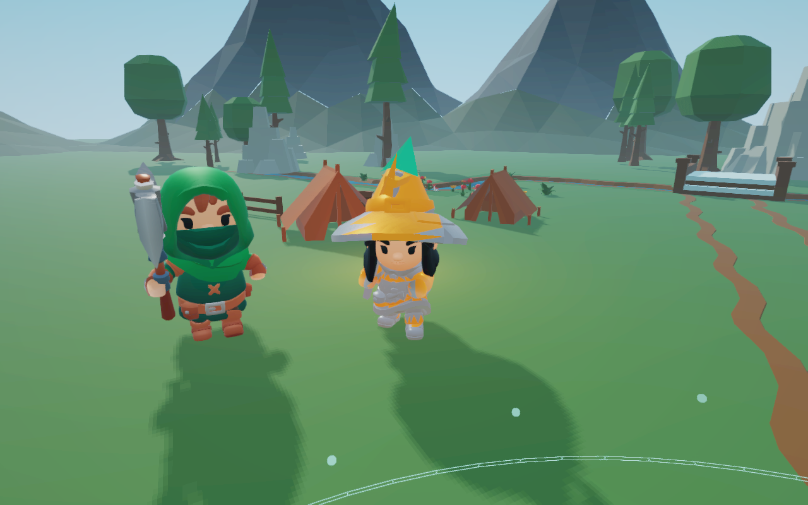

# Outpost

**Guard the last light. Bring back the dawn.**

The valley's fires have gone cold. One ember still burns beneath a forgotten sanctuary—and you're its last warden. Choose your hero, hold back the raids, and follow the light through a four-chapter adventure.



## Play together — two-player co-op

Choose **Play Together** on the main menu. Both computers must install the same v4.1 release.

1. On one computer, choose your name/class and difficulty, then **Host New Game**.
2. Copy the invite from the lobby and send it to your partner.
3. On the second computer, choose a name/class, click **Paste Invite**, then **Join Session**.
4. Choose your upgrades and both press **Ready**.

Use the same Wi-Fi/LAN or a private VPN. Allow the host game through your firewall on TCP port **27878**. If the host has several network addresses, **Next Address** selects the address reachable by your partner. Public internet matchmaking/relay is not included.

Both wardens defend one sanctuary through four chapters. Enemies are scaled for two players. Hold **G** beside a downed partner for three seconds to revive them; damage interrupts reviving. The sanctuary heals nearby players. Hold **G** there to spend one potion repairing 100 sanctuary health. Mage heavy bolts can heal an injured partner or repair the sanctuary. There is no friendly fire.

Your ally has a green health bar above their head; your own health and stamina stay in the top-left frame.

Each chapter grants an upgrade point and improved visible equipment. Each player has independent health, stamina and potions. Either player can pause; both must unpause to continue. A disconnect freezes combat, and reconnecting with the original class restores that player. The host's **Resume Co-op** restarts the saved chapter with its upgrades. Co-op uses a separate checkpoint and preserves solo saves.

## Who will carry the ember?

- **Warrior:** get close, chain sword swings, parry a strike, and answer with a powerful counterattack.
- **Archer:** keep your distance, pick your openings, and trade your bow for a crossbow as your equipment improves.
- **Mage:** send piercing spells through enemies. The crafted Dawnweaver staff turns a perfect charged shot into a healing ward for the survivor or sanctuary.

Name your warden, choose **Easy, Normal, Hard, or Extreme**, and light the beacon. The difficulty stays with your adventure.



## Every swing matters

New to the valley? Every newly created warden opens a safe, hands-on tutorial. Practice movement, aiming, attacks, dodging, charging, parrying, equipment, and sanctuary healing. Lessons advance when you perform the action. Lessons appear in a central panel with one action to follow. Skip training from that panel when you are ready. Your campaign stays separate.

Your action belt puts strike, charge, parry, lunge, healing, and equipment together at the bottom of the screen. Click an action or use its shown key; hold the charge slot and release when the meter turns gold. One top-left frame combines your name, class, difficulty, level and defense with a large green health bar and a gold stamina bar, with numbers inside each meter. Hover an action slot to see what it does. The framed backpack shows your character, armor slots, item rarity, and equipment comparisons.





Bow releases and spell casts play through their follow-through and blend back into an idle or movement pose. The action belt uses lightning for charge and forward chevrons for lunge. Gentle foliage movement keeps the surroundings active.

Scouts attack quickly; brutes show a longer windup and leave a longer opening afterward. Read their rhythm before committing.

Watch your stamina. Sprint to reach a threatened gate, dodge through danger, or save enough strength for a heavy attack. Time your next light strike to continue a combo. A well-timed parry opens the way for a stronger riposte.

Point at a target and click to aim and strike; hold the mouse button to repeat basic attacks. Tap near the end of a swing to chain the next strike. Space attacks toward your facing. Bows visibly draw and release, crossbows have a full reload, and Mages raise and fire their staff. Two-handed Warrior weapons use their own swings. Movement settles during the strike and returns through recovery.

Warrior swings leave a brief, soft trail along the moving blade. The trail follows the weapon's size and direction, with a warmer accent on heavy attacks, then fades before recovery finishes.

Each class has a combat reward. **Warrior:** parry to empower your next strike by 20%. **Archer:** dodge through an incoming hit to empower your next shot by 30%. **Mage:** light hits build up to three resonance stacks, each adding 20% to your next heavy cast. Bonuses expire, so watch the mastery cue above the action bar. The charge bar highlights the perfect release window; a contact marker and brief melee impact pause make hits easier to read.

Enemies have plans of their own: scouts flank, brutes push forward, archers retreat and reposition, and spellcasters can heal wounded allies. Read their attack warnings and interrupt them before they finish.

From the third wave onward, some raiders arrive as **elites**. Gold ground rings, labels, health bars, and radar marks identify them. They have 50% more health and award 40 crystals instead of 15.

Each siege has a different formation: fast scout raids, armored siege columns, hexers with bodyguards, and mixed ambushes. Decide which threat to deal with first.

**Gold boss attacks can be parried. Red and purple attacks must be evaded.**



## Four places. One last fire.

Your journey starts in a meadow camp among wildflowers, fallen logs, and a winding stream. Beyond it lie the **Ash Cemetery**, the **Frozen Pass**, and the **Hollow Necropolis**.

Hold the sanctuary through two four-wave sieges, then face the **Ash Warden** and **Hollow King** in their own boss-only chapters. Slams, rushes, expanding shockwaves, and delayed spell seals keep those duels moving. Below half health, the bosses become more dangerous.

Boss duels have a driving battle score that intensifies when the boss becomes enraged. Defeated foes fall instead of disappearing; armored foes settle into a grounded resting pose. Clear a chapter to hear the victory fanfare, see your warden celebrate, and collect congratulations and new weapon unlocks. Crossbows now visibly aim, fire, and reload between shots.

Fallen enemies remain on the ground, then fade where they fell. The meadow river continues into wooded banks beyond the clearing.

Trees, large stones, and standing columns now have physical footprints. Dashes stop at them, and enemies steer around them. Foliage and open tents remain traversable.

Curved dirt and stone roads pass through each sanctuary and continue beyond the visible play area into the wooded horizon, so the road never stops at the edge of the scene. Natural tree belts and undergrowth frame each chapter in its own style. Their surfaces receive shadows and follow the day/night lighting. Birds cross the skyline while wind carries seeds through the meadow.

Mountains rise beyond the clearing. Over an eight-minute cycle, the sun crosses the sky, daylight warms into sunset, and the moon and stars take over. Light and shadows change with them. The clock beside the radar shows the time, and your save remembers it.



The HUD tells you how many waves remain. Chapter endings give you a moment to read the story, change equipment, and prepare for what comes next. The Chronicle keeps the valley's story close at hand.



## Make the warden your own

Earn crystals from defeated enemies and spend them at the sanctuary workshop. Improve **health, damage, stamina, recovery, speed, defense, and sanctuary strength** separately. The first sanctuary upgrade also builds a guardian ward: two hovering crystals fire a short-range support beam every four seconds. It weakens nearby enemies but cannot deliver the finishing blow. Its HUD meter shows when the next shot is ready. The workshop Supplies tab also offers a clearly priced sanctuary repair button. Between raids, the chapter banner previews the incoming formation.

Forge **Iron, Runic, and Dawnsteel armor**, then mix helmets, chest armor, greaves, and boots. Equipment visibly fits each class: a full Warrior helm, an open-faced Archer helmet, and an armored Mage hat. Change your sword, longsword, axe, bow, crossbow, wand, or staff and see it on your hero.

Open your inventory for a rotatable, zoomable character preview and real equipment thumbnails. Select an item to compare its stats, then press Equip or Enter. Double-clicking or dragging into a matching slot also equips it. Filter weapons or armor, or choose Best Gear to put on your strongest set. Right-click a slot to remove armor. Combat pauses while you choose.



Need to recover? Follow the center marker into the sanctuary's clearly marked healing ring. It restores health faster while you stand inside. Press **G** there to spend 30 crystals and repair 100 sanctuary integrity. Chapter transitions also send supplies to restore part of its integrity. Keep potions handy for fights farther from home; you can carry five and restock at the workshop.

The Mage's tier-three **Dawnweaver** is a support weapon as well as a damage weapon. A charged shot glows jade and heals an active survivor it crosses, or restores the sanctuary if the shot reaches the center. Ordinary staff attacks still damage enemies.

## More than holding the center

Watch the radar for optional opportunities. Recover a lost supply cache, find a survivor and escort them home, or awaken a waystone and defend it for 14 seconds. Enemies can attack the survivor and waystone. Stay close, pick your fights, and decide whether the extra reward is worth leaving the sanctuary.

Completed objectives grant crystals, supplies, and an **ember blessing**. Clearing siege waves also earns embers. When the field is clear, return to the sanctuary and press **G** to choose one of three blessings. Build around heavy strikes, healing on kills, rewarding parries, faster dodges, stronger projectiles, or a tougher sanctuary. Blessings have three ranks and stay with your save.

**Chapter Feats:** open **Chronicle → Chapter Feats** from the pause menu to see three optional goals per chapter. Land charged hits, parry attacks, and finish a field objective—or evade boss attacks in a boss chapter. Each completed feat awards **15 bonus crystals when the chapter ends**, up to 45 per chapter. Progress and awarded rewards stay in your save. Use the arrows to review other chapters.

**Recovery Wisps:** elites and every fifth defeated enemy leave a teal wisp. Walk into it to recover up to **18 health and 26 stamina**. Wisps wait when both resources are full and fade after 30 seconds of active play. Menus pause their timers, and saving preserves them.

Hold **G** beside a supply cache to recover it; interact with a survivor or waystone to begin its objective. Objective timers pause when you open a menu. Failed optional objectives leave the main campaign playable.

## Your wardens and saves

Choose **Players & Saves** on the title screen to see your created wardens, classes, chapters, difficulty, and defeat counts. Continue any of their adventures, or choose **Delete** to remove a warden and their checkpoint after confirmation. Creating another warden preserves previous saves and chapter checkpoints. Existing saves are added to the history automatically when you open it or create a new character.

Defeated? **Retry Chapter** restores the current warden's equipment and upgrades from chapter entry.

## Pick up and play

| Action | Default input |
| --- | --- |
| Move | W A S D |
| Light attack | Space or left click |
| Charged heavy | Hold and release Q |
| Sprint / dodge | Left Shift / Left Ctrl |
| Parry / lunge | F / R |
| Inventory / potion | Tab / H |
| Interact / sanctuary blessings | G |
| Workshop near the sanctuary | E |
| Orbit the camera | Hold right mouse button |
| Pause / mute | Escape / M |
| Save / load | F5 / F9 |

Keyboard controls can be changed in Settings. Your adventure saves your chapter, difficulty, upgrades, equipment, and enemies still to come. Each location has its own music, with percussion that rises during battle.

## Play Outpost

[**Download a published release**](https://github.com/Chris020606/JavaGame/releases)

Choose the archive for your computer: Windows, macOS Apple Silicon, macOS Intel, or Linux. Extract it, keep its folders together, and launch Outpost. Java is included.

**[Download Outpost v4.1.0](https://github.com/Chris020606/JavaGame/releases/tag/v4.1.0)** for Windows, Linux, or Mac. [Watch the 30-second gameplay video](https://github.com/Chris020606/JavaGame/releases/download/v4.1.0/Outpost-v4.1-Gameplay-30s.mp4). Get current packages from successful [development builds](https://github.com/Chris020606/JavaGame/actions/workflows/build.yml), or run from source with JDK 24 or newer:

```sh
./gradlew run
```

<details>
<summary>What's changed?</summary>

- **4.1:** independent weapon and armor purchases, green ally health above their head, directional co-op movement animations, smoother camera follow and restrained melee impact feedback. Existing inventories are preserved.
- **4.0:** two-player host/join co-op campaign, balanced encounters, shared sanctuary, revives, support magic, upgrades, reconnects and separate chapter checkpoints.
- **3.5:** optional Chapter Feats reward charged hits, parries, objectives and boss dodges; the Chronicle tracks progress and earned rewards across all chapters.
- **3.4.1:** more forgiving Archer/Mage hits, faster projectiles, and gentle launch aim assistance toward nearby visible targets.
- **3.4:** Recovery Wisps give battlefield health and stamina, with glowing pickups, nearby labels, radar markers, and save support.
- **3.3.1:** fixed grass covering the river, restored blue water, and removed the ground tile edges along its banks.
- **3.3:** meadow riverbanks and chapter roads blend into natural woodland edges, with the bridge aligned across the river; chapter skies shift with their biome; blessing clicks immediately apply and confirm their effects; cached terrain, model materials and transforms reduce repeated per-frame work.
- **3.2:** blessing cards respond across the whole card, with hover feedback; chapter roads continue beyond view into themed tree lines; modern streetlights are removed, and projectile checks skip obstacles outside the shot's bounds.
- **3.1.1:** extended roads into the horizon and added natural edge groves.
- **3.1:** unified top-left player frame, balanced title menu with a gold New Game button, cleaner save-library navigation and confirmed deletion, and scenery cover that blocks projectiles and makes ranged enemies reposition.
- **3.0:** fantasy unit-frame health/stamina display, coordinated navy-and-gold menus, continuous lit curved roads and camp paths, flying birds and drifting meadow seeds.
- **2.9:** tutorial for every new warden, central lessons, larger labeled vitals, independent player/save history, and simplified menus.
- **2.8.1:** physical tree, stone and column footprints; collision-safe dashes; enemies steer around scenery.
- **2.8:** chapter-entry checkpoints and retry, gold-marked elites with bonus crystals, and readable HUD backing on bright terrain.
- **2.7:** clean health/stamina bars, clearer sanctuary healing and repair guidance, higher sanctuary integrity with chapter resupply, and the Dawnweaver charged support weapon.
- **2.6:** original iron-and-parchment interface, clickable six-slot action belt, framed backpack/armor slots and matching workshop/menus.
- **2.5:** short, soft trails follow the actual Warrior blade instead of a floating attack arc; pooled impact particles and cached hand attachments/text layout.
- **2.4:** safe interactive tutorial, class mastery bonuses, charge/contact/recovery HUD cues, ground shading and chapter atmosphere, and rendering optimizations.
- **2.3:** grounded corpses, extended wooded riverbanks, smooth class/weapon animation transitions, mouse aiming, better attack timing and clearer releases.
- **2.2:** optional supplies, survivor escorts and waystone defenses, persistent ember blessing builds, distinct siege formations, and a reproducible extended gameplay trailer.
- **2.1:** dedicated boss/enrage music, animated deaths and celebrations, victory fanfare and congratulations, crossbow reloads, and fixes for boss-enrage and post-boss inventory crashes.
- **2.0:** corrected Dawn weapon colors, real inventory thumbnails and comparisons, a bridge that crosses the stream, mountain scenery, and a saved day/night cycle.
- **1.9:** fitted armor for every class, restored Warrior swing animations, a livelier meadow, animated hero selection, and a refreshed player guide.
- **1.8:** instant all-gear playtest with class/chapter selection and a separate save.
- **1.7:** chapter music, richer sound effects, redesigned workshop, natural scenery layouts, and new attack effects.
- **1.6:** smarter squads, four difficulties, distinct chapter environments, armor, and an equipment preview.
- **1.5:** timed combat, skeletal bosses, and upgraded lighting.
- **1.4:** four-chapter story, boss-only levels, sprinting, dodging, and a living sky.
- **1.3:** imported environment models and a new HUD.
- [**1.2 — Warlords and Weapon Loot**](https://github.com/Chris020606/JavaGame/releases/tag/v1.2.0): published desktop downloads.
- [**1.1 — Heroes and Inventory**](https://github.com/Chris020606/JavaGame/releases/tag/v1.1.0): published desktop downloads.
- [**1.0.3**](https://github.com/Chris020606/JavaGame/releases/tag/v1.0.3): earlier desktop release.

Versions 3.5.0 and 4.0.0 are published desktop releases; versions 1.3–3.4.1 were development updates.

</details>

Characters and animation are by KayKit; scenery is by Kenney. Music and sound were created for Outpost. Full credits are in [THIRD_PARTY_NOTICES.md](THIRD_PARTY_NOTICES.md).

Crafting a weapon or armor tier grants only that tier. Lower tiers remain separate purchases. Existing saves retain their previous inventory.

Boss victories award **120 crystals and one missing class weapon**. Armor comes from the forge. Defeating the Hollow King now reveals an eight-second dawn celebration before the final results.
