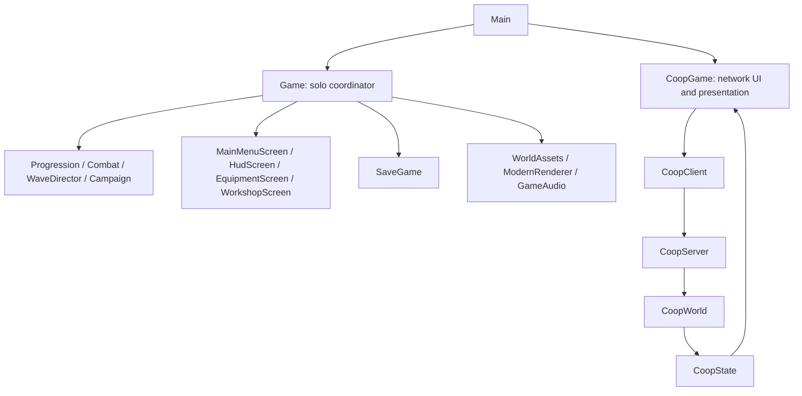

# Architecture

## Runtime ownership

`Main` initializes the native window, chooses solo or co-op, then calls `update` followed by `render` every frame. It disposes the active session before closing the window. The Gradle `run` task supplies macOS's required first-thread flag.

`Game` owns a solo session: player, progression, wave director, actors, projectiles, temporary effects, screens and save paths. The `GameState` enum governs input and simulation. Inventory and workshop are additional overlay flags, not enum states. When they are open, combat pauses.

`EnemyFocus` keeps client-side focus selection, while `TargetFrameScreen` draws enemy identity, health and cast timing. It does not alter hit rules. `ChapterSelectScreen` returns a chapter index; `Game.travelToChapter` validates unlocks, clears encounter-local objects and writes a new checkpoint.

`MainMenuScreen` draws buttons and returns an `Action`. `Game` interprets that action and performs state transitions or disk access. Keep view layout out of persistence code and native draw calls out of pure combat rules. Other legacy screens still perform some button handling during `Game.render`; changing that ordering requires care.

## Solo frame

`Game.update` clamps the frame delta, applies equipment settings, handles overlays/tutorial/outcomes, updates audio, routes input by state, then advances active combat. Combat includes player movement and attack windows, projectiles, enemies, hazards, waves, rewards and defeat/completion checks.

The player attack has separate start, impact and recovery times. Damage/projectile emission happens at impact, not when the button is pressed. `HeroClass` and `Combat` describe attacks; `Entities.Player` presents the corresponding poses. `HeroShot` tracks hit enemies so piercing magic does not hit the same enemy every frame. `Projectile` represents hostile shots.

`Game.render` prepares offscreen inventory textures before beginning the UI pass. It renders the shadow map, lit world, effects and screens. A draw-time button can open inventory, so a new inventory is drawn on the following prepared frame. Loading render textures lazily from a button previously caused first-open crashes.

## Co-op frame and threads

`CoopWorld` is the host's simulation. It uses no window, keyboard, GPU or disk APIs. Its public mutation/snapshot methods synchronize access. `CoopServer` receives player intentions, advances the world, and sends snapshots. `CoopClient` handles transport; `CoopGame` presents snapshots using separate hero rigs and interpolated positions.

Network threads do not animate or draw Raylib models. `CoopGame` updates native presentation on the window thread. A client never authoritatively decides damage or progression. Inputs use sequence numbers; stale/disconnected input pauses the session. See [the format guide](DATA_FORMATS.md) before changing packets.

## Rendering and assets

`ModernRenderer` owns render targets, shadow and postprocessing passes. `WorldAssets` owns world models, materials, animation views and scenery transforms. `Entity`/`Player` own player model animation and pose state. `EquipmentScreen` owns its preview and thumbnail render textures. Each owner must unload its native objects once, while the graphics context still exists.

Animation `update` calls are not pure Java memory operations: a wrong skeleton or native frame pointer can crash the process. Read [the asset guide](ASSETS.md) before changing models.

## Coordinates and units

- Gameplay movement and hit tests use the X/Z ground plane. Y is visual height.
- Facing/yaw are degrees; time values and deltas are seconds.
- Enemy `attackTime` counts down. Player attacks also track duration and impact.
- `Campaign` uses global waves 1–10. Chapter boundaries are 4, 5, 9 and 10.
- The third chapter is the highland/frost presentation. The legacy `Arena` value alone does not identify the current chapter.
- Mage UI calls its resource mana. Some internal fields and save/network names remain `stamina` for compatibility. Do not rename stored keys merely to improve a Java variable name.
