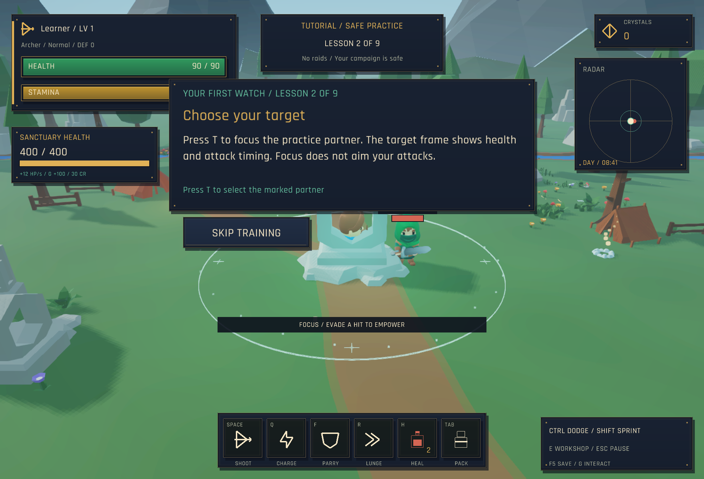

# Warden's Journey: design and implementation

This pass moves the game toward a readable small-party RPG: a stable enemy focus, clear enemy casts, persistent zone access, and recognizable landmarks. It builds on the maintained v4.2.1 code. It does not turn the four-chapter defense campaign into an MMO or import the archived balance experiment.

## Enemy focus and cast frame

`EnemyFocus` is a pure Java selection rule. The Focus action defaults to **T** and can be rebound. Cycling considers living enemies within 28 metres that have line of sight, sorted by distance. A selected actor is cleared when it dies or disappears from the current actor list.

`TargetFrameScreen` displays name, current/max health, distance and cast progress. Enemy damage resolves when `attackTime` reaches .25 seconds, so the displayed impact countdown subtracts .25 instead of counting to animation completion. Boss casts that cannot be parried use red; other casts use gold. Healing wards have their own label.

The same view/selection classes are used by solo and co-op. In co-op the candidates are snapshot presentation actors; focus is client-side and adds no protocol fields or authority. Selecting a target does not rotate shots, grant homing, ignore cover or extend range. Existing aiming and hit rules remain authoritative.

The compact HUD below 1000 pixels omits the extra target panel to preserve space. The selection still works. This is a focus feature, not a clickable enemy portrait or a complete tab-target spell system.

## Solo chapter travel

Pause and choose **World Map / Chapters**, or open it from a chapter/final-victory result screen. Closing it returns to the screen it came from. The connected route shows reached/unlocked chapters. New profiles begin with chapter 1. Completing a chapter unlocks the next; old saves infer reached and completed chapters when loaded.

`Progression.unlockedChapter` stores the highest unlocked index (0–3). It is optional in save version 2 and validated on restore. Visiting an earlier chapter does not lower this value.

`ChapterSelectScreen` only returns a selection. `Game.travelToChapter` validates access and restarts the chosen chapter with current gear, currency, health and sanctuary condition. It clears enemies, corpses, player/hostile projectiles, boss hazards, focus, recovery wisps and the optional field encounter. It resets player combat and writes a new chapter checkpoint and active save. The screen explicitly explains that this replaces the current encounter/checkpoint.

Co-op retains its shared linear campaign and existing checkpoint/reconnect flow. Solo travel is not silently applied to a remote party.

## Map authoring

- Meadow: unequal landmarks replace mirrored shrine arrangements. The western ruined garden and eastern wayfarer stop give direction cues; the central sanctuary clearing stays open.
- Cemetery: low altar/coffin/fire-basket details frame the boss space without filling its dodge area.
- Highlands: road control points bend more noticeably through the pass; distant ruin markers identify the bends. Wave spawning and combat balance are unchanged.
- Campfires: ember positions are derived from authored campfire props, avoiding effects left at old coordinates after moving a campsite.
- Tree visibility: `SceneryVisibility.treeOpacity` fades trees only when their ground projection lies between the camera and hero and intersects a conservative canopy corridor. The shadow pass stays opaque. This improves visibility without moving collision footprints or changing projectile cover.

The environment is still an authored arena per chapter. These are landmark/road/readability improvements, not a new open-world terrain system.

## Comments and maintenance

Comments are placed around behavior that is easy to break: native actor references, cast-impact timing, optional save migration, travel resets, camera occlusion and separate visible/shadow passes. Avoid comments that merely repeat a Java assignment.

Relevant files:

- `EnemyFocus.java`, `TargetFrameScreen.java`
- `ChapterSelectScreen.java`, `Game.travelToChapter`, `Progression`
- `EnvironmentLayout.java`, `SceneryVisibility.java`, `WorldAssets.java`
- `Config/Controls.java`, `CoopGame.java`

Checks: `AdventureSystemsTest`, `inputSmokeTest --args=--adventure-review`, four-chapter art review, full solo input regression, and native co-op scenarios. Existing protocol fixtures ensure no wire-layout drift.

## Validation record

115 unit tests pass, including focus selection/visibility, old custom key bindings, chapter unlock save migration and scenery fade boundaries. The targeted native adventure review verifies the real focus key and cast frame, pause-map button, encounter reset, save/load, legacy reached-zone inference, locked-zone guard and return from the map to victory. The full solo regression passed in4m20s; all three native co-op pairings passed in42s with focus selection assertions on both clients. Four-chapter art captures and the target/map captures were visually reviewed. Final packaging and cross-platform release status are recorded by the release workflow.

## v4.3.1: focus training and local map identity

Training now has nine steps. After movement, FOCUS requires a real visible partner selection with the configured focus key (T by default). `Tutorial.focus()` only advances that step. `Game.prepareTutorial` keeps that actor for the following strike lesson, so selection is not lost immediately. Practice target frames hide the artificial health and identify the partner as safe practice. The Archer dodge bonus is named Precision to distinguish it from target focus; its numbers are unchanged.

`WorldLandmarks` contains small chapter-local named areas. A location caption appears near camps/ruins outside tutorials and boss fights. These names do not grant rewards or introduce save keys. Keep their coordinates aligned with authored scenery if a campsite moves.

`EnvironmentLayout.addTravelDetails` uses an independent random seed, keeping existing cover and tree placement stable. Soft verge vegetation stays outside the sanctuary's central clearing. Meadow lily pads are placed on known water tiles below ground height. These props do not add navigation obstacles or change projectile cover.

Tests cover rebinding the focus lesson, demonstrating focus before striking, landmark bounds and lily placement. The native tutorial scenario presses the real focus key for every class. Map-detail and four-chapter art reviews provide captures for visual checking.

Validation for v4.3.1: 117 unit tests; full solo input regression (4m 22s); focused all-class tutorial review (40s); co-op smoke (14s); four-chapter art and map-detail captures; final format/package checks passed.
