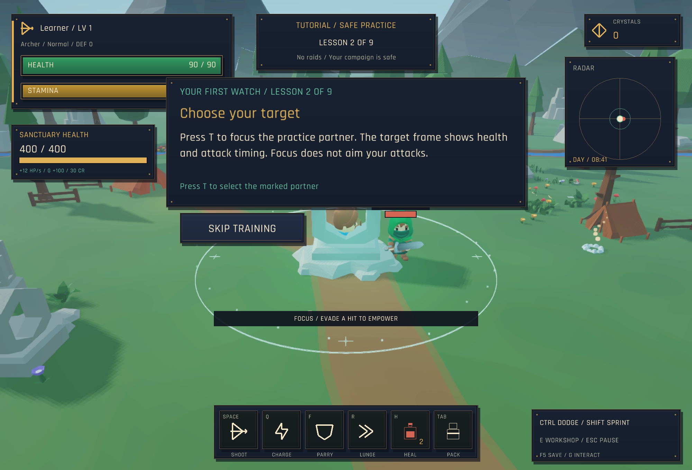

# Warden's Journey: design and implementation

This pass moves the game toward a readable small-party RPG: a stable enemy focus, clear enemy casts, persistent zone access, and recognizable landmarks. It builds on the maintained v4.2.1 code. It does not turn the four-chapter defense campaign into an MMO or import the archived balance experiment.

## Enemy focus and cast frame

`EnemyFocus` is a pure Java selection rule. The Focus action defaults to **T** and can be rebound. Cycling considers living enemies within 28 metres that have line of sight, sorted by distance. A selected actor is cleared when it dies or disappears from the current actor list.

`TargetFrameScreen` displays name, current/max health, distance and cast progress. Enemy damage resolves when `attackTime` reaches .25 seconds, so the displayed impact countdown subtracts .25 instead of counting to animation completion. Boss casts that cannot be parried use red; other casts use gold. Healing wards have their own label.

The same view/selection classes are used by solo and co-op. In co-op the candidates are snapshot presentation actors; focus is client-side and adds no protocol fields or authority. Selecting a target does not rotate shots, grant homing, ignore cover or extend range. Existing aiming and hit rules remain authoritative.

The compact HUD below 1000 pixels omits the extra target panel to preserve space. The selection still works. This is a focus feature, not a clickable enemy portrait or a complete tab-target spell system.

## Solo chapter travel

Pause and choose **World Map / Chapters**, or open it from a chapter/final-victory result screen. Closing it returns to the screen it came from. The connected route shows reached/unlocked chapters. New profiles begin with chapter 1. Completing a chapter unlocks the next; old saves infer reached and completed chapters when loaded.

`Progression.unlockedChapter` stores the highest unlocked index (0–3). It is optional in save version 2 and validated on restore. Visiting an earlier chapter does not lower this value.

`ChapterSelectScreen` only returns a selection. `Game.travelToChapter` validates access and restarts the chosen chapter with current gear, currency, health and sanctuary condition. It clears enemies, corpses, player/hostile projectiles, boss hazards, focus, recovery wisps and the optional field encounter. It resets player combat and writes a new chapter checkpoint and active save. The screen explicitly explains that this replaces the current encounter/checkpoint.

Co-op retains its shared linear campaign and existing checkpoint/reconnect flow. Solo travel is not silently applied to a remote party.

## Map authoring

- Meadow: unequal landmarks replace mirrored shrine arrangements. The western ruined garden and eastern wayfarer stop give direction cues; the central sanctuary clearing stays open.
- Cemetery: low altar/coffin/fire-basket details frame the boss space without filling its dodge area.
- Highlands: road control points bend more noticeably through the pass; distant ruin markers identify the bends. Wave spawning and combat balance are unchanged.
- Campfires: ember positions are derived from authored campfire props, avoiding effects left at old coordinates after moving a campsite.
- Tree visibility: `SceneryVisibility.treeOpacity` fades trees only when their ground projection lies between the camera and hero and intersects a conservative canopy corridor. The shadow pass stays opaque. This improves visibility without moving collision footprints or changing projectile cover.

The environment is still an authored arena per chapter. These are landmark/road/readability improvements, not a new open-world terrain system.

## Comments and maintenance

Comments are placed around behavior that is easy to break: native actor references, cast-impact timing, optional save migration, travel resets, camera occlusion and separate visible/shadow passes. Avoid comments that merely repeat a Java assignment.

Relevant files:

- `EnemyFocus.java`, `TargetFrameScreen.java`
- `ChapterSelectScreen.java`, `Game.travelToChapter`, `Progression`
- `EnvironmentLayout.java`, `SceneryVisibility.java`, `WorldAssets.java`
- `Config/Controls.java`, `CoopGame.java`

Checks: `AdventureSystemsTest`, `inputSmokeTest --args=--adventure-review`, four-chapter art review, full solo input regression, and native co-op scenarios. Existing protocol fixtures ensure no wire-layout drift.

## Validation record

115 unit tests pass, including focus selection/visibility, old custom key bindings, chapter unlock save migration and scenery fade boundaries. The targeted native adventure review verifies the real focus key and cast frame, pause-map button, encounter reset, save/load, legacy reached-zone inference, locked-zone guard and return from the map to victory. The full solo regression passed in4m20s; all three native co-op pairings passed in42s with focus selection assertions on both clients. Four-chapter art captures and the target/map captures were visually reviewed. Final packaging and cross-platform release status are recorded by the release workflow.

## v4.3.1: focus training and local map identity

Training now has nine steps. After movement, FOCUS requires a real visible partner selection with the configured focus key (T by default). `Tutorial.focus()` only advances that step. `Game.prepareTutorial` keeps that actor for the following strike lesson, so selection is not lost immediately. Practice target frames hide the artificial health and identify the partner as safe practice. The Archer dodge bonus is named Precision to distinguish it from target focus; its numbers are unchanged.

`WorldLandmarks` contains small chapter-local named areas. A location caption appears near camps/ruins outside tutorials and boss fights. These names do not grant rewards or introduce save keys. Keep their coordinates aligned with authored scenery if a campsite moves.

`EnvironmentLayout.addTravelDetails` uses an independent random seed, keeping existing cover and tree placement stable. Soft verge vegetation stays outside the sanctuary's central clearing. Meadow lily pads are placed on known water tiles below ground height. These props do not add navigation obstacles or change projectile cover.

Tests cover rebinding the focus lesson, demonstrating focus before striking, landmark bounds and lily placement. The native tutorial scenario presses the real focus key for every class. Map-detail and four-chapter art reviews provide captures for visual checking.

Validation for v4.3.1: 117 unit tests; full solo input regression (4m 22s); focused all-class tutorial review (40s); co-op smoke (14s); four-chapter art and map-detail captures; final format/package checks passed.

## Working-tree XP repair (2026-11-08)

Enemy-death feedback advertised XP without awarding it. `Progression.rewardEnemy` now grants 25 XP for a regular enemy or 300 for a boss; `rewardElite` adds the remaining 60 XP for an 85-XP elite total. The existing chapter-clear award remains separate. Four regular defeats reach level 2, grant one attribute point, restore health and apply the existing level stats. Excess XP carries forward; level 1000 caps further awards within save bounds.

`usesLevelPoint` and `canPurchase` now supply the workshop's currency and availability rules as well as the purchase mutation. Resilience costs crystals; other attributes prefer a point when available, then crystals. Buttons show the currency actually charged. The HUD draws XP values once and uses the configured Workshop binding for its point hint.

Validation: 125 unit tests pass, including actual reward entry points, elite/boss totals, point spending, disk save/load and level-cap checks. `inputSmokeTest --args=--xp-review` exercises four deaths through Game's update, clicks the Power training button, and reloads the save. Captures are `build/xp-level-up.png` and `build/xp-training.png`. This is a solo progression fix; co-op uses its existing separate credits system.

The entry-screen pass removes gameplay help from the title menu, reveals the world background, separates character creation and preview panels, and marks class/difficulty selections. `--entry-review` captures both 1280x800 and 1000x680 layouts. Larger meadow ridge/ruin pieces were added outside actor bounds. Other working-tree game changes are retained.

## Story and returning citizens (2026-11-11)

New characters see OpeningStory before control begins: criminal betrayal, Aethelgard as refuge, Beacon teleport/rescue and defense, then mentor and deployment. Enter or Space advances the four panels. The opening pauses game updates. It runs for new characters, not existing saves.

Practice spawning is restricted to PLAYING. finishTutorial clears practice actors, target selection, shots, hazards, corpses and pending combat before restoring any saved practice-return encounter. The Citadel tutorial no longer creates a practice actor when movement advances to Focus.

CitizenRoutine provides home-centred walking and resting with collision checks; approaching players and active conversations pause movement. CitadelHub uses the same moving coordinates for rendering and interaction. Rescue ownership still uses the existing persisted rescuedSurvivors count; transient walking positions reset near each citizen's home when the application restarts. The existing four named survivors appear as they are rescued.

Starter gifts use RECEIVE plus the actual tier-zero weapon name. Existing class-specific introductory greetings explain the gift before acceptance; forging remains available after receipt.

## Discoverability and rescue expansion (2026-11-11)

Removed the outline circles under street lamps (DrawCircle3D draws rings rather than filled illumination). Portal and nearby-NPC interaction markers remain meaningful.

The city now shows ProgressionSummary: XP, current max health/attack power and adjacent next-level bars. Progression owns preview calculations; tests compare them to actual level-up results for every class, armed/unarmed. The dossier also states exact next-level gains. City equipment guidance identifies the matching mentor and world direction/distance, with crystal/level requirements. Ember Blessing availability now has a larger central card stating its benefit and the Beacon/clear-field/interact requirements.

FieldEvent offers six survivor escorts (waves 2, 4, 6, 7, 8, 9), preserving supplies on wave 1 and the waystone encounter on wave 3. Boss-only chapters have no escort. Added Mira the Weaver and Owen the Baker as the fifth/sixth returned citizens using existing models and CitizenRoutine; their greetings and stories describe rebuilding the city. Existing rescue count and event saves remain compatible.

## Inventory growth, minimap and progression balance

Removed the persistent city stat/crafting panels. InventoryGrowth now shows adjacent current/next-level health and power bars under the character preview. The opening introduces returning to the class mentor to forge equipment once per new character; mentor gift conversations retain their crafting guidance. CityMinimap is north-up with player, matching mentor, other service NPCs and expedition portal markers.

Level growth preserves the first two increments (+10 attack/+25 HP), then becomes +3 attack/+10 HP per level. Next-level previews derive from those same curves. Unarmed growth stays +2 attack. Solo non-boss enemies gain eight extra base HP per wave beyond wave four; co-op party-scaled enemies and bosses retain existing health tuning. Tier-two weapon/armor forging costs 400/380 crystals; tier-three costs 850/800. Existing level requirements and ownership remain intact. Old saves accept the previous health maximum then clamp to the revised cap.

Balance regression verifies an Easy wave-nine regular survives a level-12 Legendary basic hit without exceeding three base hits. This does not prohibit one-shot critical/heavy attacks or maximum attribute builds. Full campaign co-op tests remain part of validation; subjective combat feel still benefits from player feedback.

## Merchant stock and quiet combat HUD

CityMinimap now follows the combat radar frame: 160px panel, 59px circular radar, cardinal labels, muted crosshair, teal gate/gold class mentor/white player, top-right placement. City coordinates are scaled to fit the city boundary inside the circle.

BlessingReminder displays for four seconds after entering a safe interval with unspent embers. Any enemies, queued arrivals, tutorial, inventory or workshop suppress it. The card appears at the right side instead of over the player's combat view. It does not consume a blessing or change claim requirements.

Torvald's merchant button opens the supplies tab (legacy selectTab mapping requires index 2). Merchant stock adds Heartwood Charm (+5 max HP/rank), Traveler's Flask (+5 stamina/mana capacity/rank) and Restoration Incense (+1 resource regeneration/s/rank). Each caps at five ranks and costs 180 + 140 per existing rank. Ranks persist as optional caravan.0..2 keys with zero defaults. Existing health migration includes charm capacity. Purchases immediately apply and save through the workshop coordinator. Potions and Beacon repair remain repeatable purchases.

MerchantReminderTest checks safe-window expiry and combat suppression, prices, cap, effects and persistence. Native inspection includes merchant-stock.png.

## Vendor correction

Torvald was interactable but absent from drawNpcs, and his old position (-5.5,15.5) lay inside the wagon footprint. He is now drawn with the matching Barbarian rig at (-2.5,15.5), beside the open central market avenue. Proximity and minimap use CitadelNpc's same position. The inspection suite captures torvald-market.png.

WorkshopScreen stock is now determined by activeMentor: class mentor means equipment forge; null means Torvald's provisions. Removed switchable tabs so mentor visits cannot expose caravan upgrades and merchant visits cannot expose equipment forging. VendorStockTest checks role isolation and placement. Existing tutorial NPC proximity expectations follow the corrected position.

## Individual armor ownership

The class forge offers four separately priced piece buttons per tier. Head/boots cost 20%, chest 40%, legs 30% of the former bundle price (rounded); buying a slot grants only that slot/tier and never auto-equips it. Inventory ownership and Best Gear use per-slot masks. Progression stores optional ownedArmor.HEAD/CHEST/LEGS/BOOTS bitmasks; saves without these inherit their old tier ownership for every slot. The aggregate ownedArmor mask stays as the union for legacy metadata. Validation rejects equipped pieces that are not owned. The old bundle purchase method is retained for legacy/test callers; the game UI uses only slot purchases.

The empty boots pictogram is now a matching pair with cuff, shaft, toe and sole. City scenery adds residential tree pockets and a few rural/workyard props outside the central avenue. ArmorPiecesTest covers isolated ownership, duplicate purchase prevention, equipping, persistence and legacy set migration. Inspection includes individual-armor-forge.png.

## Forge clarity and city service discovery

ForgeAdvice supplies armor hover explanations: wrong class mentor, missing starter, required level, exact missing crystals, owned/equip guidance, or defense change against the equipped slot. Purchase confirmations identify the forged piece and tell the player to equip it from inventory. Weapon buttons name their restriction instead of saying BLOCKED. Inventory dossier now correctly calls defense flat damage blocked, matching damagePlayer's subtraction rule.

City radar gives Torvald a distinct diamond marker. Hovering service markers shows NPC name and services without a permanent crafting panel. ForgeAdviceTest covers class, level, currency, gain and ownership explanations.

## Forge visual redesign

The forge now selects one quality tier at a time across three top tabs. A dedicated weapon card shows a large class weapon icon, weapon power and equipped comparison. Four larger armor cards show slot icons, protection values, equipped deltas and individual forge buttons. This replaces the dense three-column/four-small-row layout; vendor stock restrictions, save format and purchase rules are unchanged. Selection affects only presentation. Existing hover reasons and purchase feedback remain in the footer. The native inspection screenshot individual-armor-forge.png shows the new layout at 1280x800.

## City character labels and district arrivals

CityPresentation draws contextual name/role labels for at most two nearby service NPCs or rescued citizens. It uses CitadelHub.npcX/npcZ so labels follow CitizenRoutine movement. Camera-facing and screen-bound checks avoid offscreen labels; names are hidden during dialogue, inventory and shops. Labels are proximity aids rather than a through-wall navigation system.

District arrivals use authored coordinate regions (market, southern gate, castle approach, archery green, forge, sanctum, cathedral and riverside). An 0.8-second dwell precedes a 3.5-second title; crossing back and forth briefly does not retrigger the label. Titles do not affect quests or save state. Update region bounds when city layout changes.

## Rescue ledger

City HUD offers a Rescue Ledger button, opening a paused roster of the six named survivors with safe/missing status from the existing saved rescue count. The overlay returns with Escape or its Return button. This view does not issue rewards, create new save keys or alter progression; citizens are unlocked in the existing roster order. Native inspection exports rescue-ledger.png.

The field rescue card now distinguishes starting an escort from bringing an active survivor to the Beacon. Active escorts show distance to the Beacon instead of repeating the generic interact instruction. Non-rescue field events retain their original instructions and timers.

## Distinct rescued citizen meshes and outskirts activity

Each rescued citizen now uses a separate generated GLB under resources/outpost/citizens: Bram/Barbarian, Kaelen/Ranger, Rowan/Rogue, Theron/Knight, Mira/Mage, Owen/Rogue_Hooded. These are existing licensed KayKit meshes rather than new downloaded artwork. tools/prepare_citizens.py appends only unarmed idle/walking clips using the established bone-name remapper. Textures remain embedded. Each citizen's model and animation allocation is separate; native loading verifies skeleton compatibility before playback and unloads all clip allocations on shutdown. CitadelNpc model paths match the visible generated models.

The previous rescued population reused two enemy meshes (raider and archer). Six individual captures now verify the changed silhouettes in the actual city; the inspection profile rescues all six. Mill-delivery sacks/wheelbarrow and a small lumber workyard add authored outskirts scenes. Nine small animated bird silhouettes circle outside the walls, independent of combat and navigation.

## Equipment comparison and service pictograms

Selected gear now shows side-by-side current/selected power or defense bars with the same scale and numeric delta. Progression.weaponDamage previews hypothetical armed damage without granting ownership, fixing comparisons while unarmed. Inventory and forge use that calculation. EquipmentPreviewTest verifies previews leave weapon ownership untouched and match a subsequently equipped starter.

Nearby city nameplates have role-specific pictograms: merchant bag, mentor class weapon, expedition shield and rescued citizen crown. Work is isolated from enemy behavior files reserved for the parallel model.

## Complete inventory layout redesign

EquipmentScreen uses a 960x640 three-column layout: character preview/equipped slots/growth, filtered collection, and selected-item details. Owned items are shown initially; Include Unowned reveals forge equipment. Categories are All, Weapons, Armor and Supplies. Selection details show a larger item thumbnail, ownership/equipped state, current/selected comparison and contextual Equip/Remove/Drink action. The character stats view occupies the collection/detail area while keeping the character and equipped slots visible.

Mouse orbit/zoom, double-click equip, drag-to-slot, right-click remove and keyboard navigation remain supported. Keyboard grid navigation is four columns. Clicking equipped gear resets category to All so its details remain selected; Delete only removes a selected item if currently equipped. A guard prevents accessing an unprepared thumbnail. Ownership/save formats are unchanged.

CitadelVisualInspection now injects native mouse events to select owned boots, equip through the details action, remove via right-click and consume a potion through Supplies, with assertions on state after each action. It captures owned/unowned collection views and the dossier. Earlier coordinate-based InputSmokeTest inventory scenarios use the old layout and will need coordinate migration before the full historical native regression is used; unit tests and the new inventory interaction checks are the validation for this redesign.

## Character stat explanations and citizen stories

CharacterStatsScreen replaces the dense dossier table with six selectable stat cards: max health, attack power, flat defense, stamina/mana capacity, recovery and movement. Each shows a value and short hint; selected-card text explains the real gameplay rule and available improvement sources. Health/power preview gains still come from Progression. This is presentation only and does not change combat math.

RescueLedgerScreen now lets players select returned citizens to read their existing lore. Missing citizens remain marked as missing; opening the ledger grants no rewards and changes no ownership. Selection resets for a different Progression owner. These UI changes do not touch the enemy behavior files allocated to the other model.

## Market and residential visual pass

CitadelHub adds a public well at (8,21), using the bundled KayKit well, with a matching circular collision footprint. Two overhead pennant strings mark Market Square entrances at z=9 and z=24. Thin wooden supports sit at x=±4.8 with collision; the central avenue stays open. Pennants use red/gold/blue cloth triangles with a small wind motion, drawn on both sides. Residential and sanctum frontages gain authored yellow/purple flowers and bushes, and the well courtyard has a tree and small barrel. Scenery uses existing licensed assets and adds no save fields or combat changes.

## Enemy combat intelligence, inventory test migration, city presentation & lore integration (2026-11-12)

EnemyCombatBehavior adds dedicated navigation intelligence: ranged kiting and sweet-spot positioning (4.5m–7.4m) with boundary deflection away from arena walls and obstacle avoidance, with an Easy difficulty safeguard (3.8m retreat threshold and gentler speed). Melee variants specialize into distinct roles: Scouts flank at 1.4m–3.0m, Raiders distribute approach angles, and Brutes anchor the center with heavy separation resistance. Zero-distance overlap and large frame steps are clamped safely. Unit test coverage increased with 8 dedicated tests in EnemyCombatBehaviorTest.

InputSmokeTest inventory mouse coordinates were migrated from the obsolete 940x600 layout to the new 960x640 design: pack Return button, post-boss weapon unlock/equip, and the full endgame equipment routine covering the 4-column collection grid, drag-and-drop to slots, right-click unequip, Enter-key equipping, category filter switching, and double-click equipping.

CityPresentation was enhanced with HUD exclusion zones (preventing 3D nameplates from colliding with the top-left Guide panel or the top-right City Radar) and point-blank suppression when the player approaches within interaction range. The district arrival title transition was fixed to immediately reset lingering banners upon crossing district boundaries, eliminating confusing stale title displays during entry dwell. CityPresentationTest adds 2 unit tests covering district classification and dwell mechanics.

Civilian silhouettes were improved by modifying tools/prepare_citizens.py to cleanly strip combat helmets, bear pelt hats, quivers, and assassin masks while preserving underlying KayKit rigs and animations, giving Bram, Theron, Mira, Owen, Kaelen, and Rowan genuine civilian appearances.

OpeningStory was reconciled with the campaign's Hollow Frost narrative, bridging the internal criminal betrayal and breached seals with the awakening of the ancient frost legions, the Primordial Beacon's solar ember, and the defense of Aethelgard. All 172 unit tests and the citadelInspection visual test suite pass.

## Boss rewards, shared rescue actors and world corrections

Boss rewards now grant currency/XP only: rewardEnemy(true) no longer unlocks missing weapons. Both immediate and outcome-screen copy state +120 crystals/+300 XP. Existing owned gear is preserved. BossEquipmentTest and EquipmentOwnershipTest now test the intended no-free-equipment policy rather than the former loot behavior.

Game routes survivor field rendering through CitadelHub.drawFieldSurvivor, selecting the next citizen by the existing saved rescue count and using the exact city mesh/animation allocations. Native skeleton compatibility checks still apply. Other field-event kinds keep WorldAssets rendering. Active field citizens walk; waiting citizens idle. Completed rescues no longer leave a lingering field actor.

Inventory preview now has an aspect-matched 960x1040 render target and revised full-body camera. Player.poseForInventory uses armed melee idle when appropriate, rather than posing every non-Archer unarmed while rendering their weapon.

Prop placement subtracts cached model-bound minimum Y (scaled), grounding props without changing terrain/building origins. City trees within 4.8m of road-tile centres are removed. Citizen collision clearance around buildings is widened; blocked starting positions search for nearby clear ground. CitizenRoutineTest simulates all six routines for a minute and verifies every position stays outside the city obstacles. Existing Antigravity EnemyCombatBehavior code is preserved.

Validation: full unit suite, native city/inventory inspection and packaging; field-survivor-shared-model.png exercises the new mission render path. Historical boss-loot assumptions in any other native scenarios must be updated before claiming the entire historical input suite passes.

## Optional city service tracking

Clicking a city radar service marker now tracks that NPC in the existing direction/distance guide. A gold ring and line identify the target on the radar; right-clicking within the circle clears tracking. Hit testing chooses the nearest marker inside eight pixels. Gatekeeper selection points to the actual portal rather than the NPC's offset position. Survivor markers are not service targets. Unarmed characters retain their mandatory mentor objective even if a service marker is selected. Tracking resets when the Progression owner changes and is not saved or tied to purchases.

CityNavigationTest covers merchant guidance, clearing, unchanged currency and starter guidance. CitadelVisualInspection injects mouse clicks to select Torvald, verifies the destination, captures city-tracked-merchant.png, then clears tracking with a right-click. This work does not modify enemy, combat or escort simulation files.

## Merchant upgrade previews

CaravanOffer derives displayed values and purchase labels from existing Progression prices, ranks and actual class resource. Cards show current-to-next maximum health, stamina/mana capacity or resource recovery. Unaffordable buttons state the exact missing crystal amount; maxed ranks show no further gain. Hover text explains permanence and that no equipment slot is consumed. Purchase feedback names the acquired rank and confirms activation. This changes neither prices nor gameplay effects. CaravanOfferTest verifies class labels, non-mutating previews, purchase agreement and cap presentation.

## Owned upgrade discovery

Inventory header now has an Upgrades count/filter alongside Character Stats. GearUpgrade considers only owned weapons with higher actual armed power or owned armor with higher protection than the currently equipped slot. It excludes supplies, unowned items and equal/downgrade pieces. Better owned items carry a gold plus marker. The filter changes no equipment automatically; equip still requires the normal action. Clicking equipped slots exits the filter so inspecting current gear remains reliable.

GearUpgradeTest covers ownership, supplies, downgrade exclusion and count changes after equipping. CitadelVisualInspection clicks the upgrade filter, equips the suggested owned helmet via the detail action, asserts the slot, captures inventory-upgrades.png and restores the slot. No enemy/escort changes.

## Inventory summary cards (2026-11-14)

Replaced the paired health/power bars beneath the character preview with two compact numeric cards. Each shows its stat label, current value and exact next-level gain, using existing Progression methods. Only XP retains a thin progress line. Values shrink for unusually large saved stats to stay inside the cards. This is an InventoryGrowth presentation change; progression, equipment comparison and combat bars are unchanged. Native inspection and packaging verify the new inventory layout.

## Distinct boss phase patterns

BossPatterns now generates shared solo/co-op ground attacks. The Ash Warden casts a locked eruption line aligned with the boss-to-target direction (3 fields, 5 when enraged). The Hollow King casts a centre marker and an incomplete crown (5 fields, 7 when enraged), leaving an escape sector. Targets lock when cast; fields do not follow players. Normal+ warnings last at least 0.9s with 0.18s stagger; Easy uses three fields, at least 1.15s warning and 0.26s stagger, without the enrage count increase. Target centres clamp within the arena.

Slams release expanding rings at 0.85s intervals: one normally, two for enraged Warden, three for enraged King. Easy keeps one. Solo and co-op use the same generator; co-op sigils target living heroes. Boss HP, rewards, move IDs and protocol are unchanged. Existing direct slam hits and other attacks remain.

BossPatternsTest covers phase counts, warning/stagger, Easy constraints, arena bounds, sideways escape from the line, ring spacing and an open crown sector. Native --boss-pattern-review checks both bosses/phase casts and no damage during warning. --boss-regression preserves native enrage timing; coopNativeTest --quick covers two-client gameplay. Updated historical king-sigil count expectations to 5/7.

## City return and interrupted-rescue fixes

Visiting the Citadel from LEVEL_COMPLETE now performs continueCampaign once before city travel. This resets the director's completed-chapter marker and writes the next checkpoint, preventing redeployment from awarding/showing the same result again. Returning during an unfinished expedition does not consume a chapter transition.

When a survivor event is still visible and the wave is otherwise clear, the wave director's inter-wave clock pauses and chapter completion is deferred. The event still updates, so it can complete or fail normally. This prevents waves 4 and 9 ending their chapters while the final rescue is unresolved, and prevents the next wave replacing an active rescue. Six opportunities remain; this does not automatically grant rescues or resurrect failed escorts.

Removed the overhead market pennants and their support collisions. Buildings, as well as props, align their lowest model bound to the ground. Citizen movement now checks cached model-space building bounds (with inverse yaw/scale), in addition to coarse collision obstacles; blocked-start recovery remains active. Nearby interaction chooses the nearest eligible NPC, using moving citizen coordinates, rather than always preferring mentors over citizens.

Native CitadelVisualInspection regression now verifies chapter-result/city/redeploy does not repeat completion, processes each of waves 2/4/6/7/8/9 with an unresolved rescue after the last enemy dies, completes all six escorts, and checks citizens against actual rendered building bounds. The scripted escort section exercises event completion and transitions rather than claiming a full manually played campaign. 194 unit tests and native regression/package pass.

### Single-player focus and winter title screen

Removed the multiplayer launcher, host/join screens, networking simulation, protocol fixtures and dedicated Gradle task. Existing single-player saves remain untouched. Updated current README and technical guides to describe the solo runtime; older development entries remain historical.

Redesigned the title screen with a moonlit citadel silhouette, layered mountains and deterministic drifting snow. The primary action follows save availability, with secondary actions grouped below. Native inspection captures both 1280x800 and the minimum 1000x680 layout.

### Winter title presentation refinement (2026-11-15)

Expanded the single-player home screen scenery with snow-edged fortress roofs, warm animated windows, fluttering banners, a beacon glow, a mountain causeway, foreground pines, faint stars and a slowly moving aurora. Added a title crest and more restrained panel framing. The profile header now indicates saved/new journey state and truncates long names without crossing the status label. Native inspection covers new and saved appearances at 1000x680 and 1280x800 respectively. No assets, save formats or gameplay rules changed.

### Interactive title sky (2026-11-15)

Removed the Single Player footer label. TitleSky owns an independent three-minute menu day/night clock, sun/moon ellipse projection and mouse capture. Grabbing either body preserves the current phase; dragging through the horizon switches day/night, and release resumes time. A centre dead zone prevents angle snapping. Sky, mountain, castle and tree colors blend with daylight; stars/aurora/window glow recede during the day. No campaign clock/save changes.

TitleSkyTest covers clock wrap/stall limits, opposite body visibility, lighting, both-body drag/release, off-target clicks and centre stability. Native inspection captures dawn/day/dusk/night and exercises real Raylib mouse events for both bodies without menu activation.

### Fortress illustration and quiet interaction (2026-11-15)

Removed the sky-drag instructional text while preserving sun/moon interaction. Rebuilt the home-screen fortress with unequal towers, a tall rear keep, roof facets and snow ledges, sparse masonry, arched mullioned windows, a crenellated curtain wall, buttresses and a portcullis gatehouse. A cliff foundation and viaduct connect it to the foreground ridge; irregular tiered pines replace repeated triangular silhouettes. Existing daylight tinting remains shared across the architecture. No new player-facing hints or labels.

### Castle clearing composition (2026-11-15)

Replaced the title's mountain backdrop, cliff foundation and viaduct with level snowy ground. A perspective stone path meets the gate and widens toward the foreground. Snow-edged evergreen clusters flank the castle and approach, leaving the entrance visible. Existing day/night tint and sun/moon controls are preserved. Verified title captures at both supported sizes and daylight phases via native inspection; rebuilt the desktop app.

### Restore previous title composition (2026-11-15)

Reverted the flat-clearing composition at the player's request. Restored the layered background mountains, original rock foundation, right-hand approach bridge/ridge and foreground pines around the detailed fortress. Day/night dragging remains, with no instruction text. This supersedes the preceding clearing entry.

### Descending mountain approach, fixed castle (2026-11-15)

Changed only the foreground terrain beneath the existing castle: the vertical rock/bridge becomes a broad mountain shoulder with a descending switchback path. Small 13–34px evergreens follow staggered contour elevations and increase modestly toward the foreground. Castle geometry and coordinates were compared directly against the prior file and remain identical; background mountains, title UI and sky behavior remain unchanged. Native inspection covers both sizes and day/night views; desktop package rebuilt.

### Denser slope, consistent citizens and shorter introduction (2026-11-15)

Expanded the title mountain's tree population from 24 to 40, with sizes 22–47px instead of 13–34px; retained castle geometry and sky/background. Citadel service NPCs now use their authored texture colors instead of extra class-colored tints. Included NPC models in the same directional shadow pass as city architecture, using matching timestamps and poses; removed nearby ground rings and artificial vertical breathing offsets.

Replaced the four-page prologue with one brief card. Removed the timed chapter-story panel during combat and its legacy timer; full chapter lore remains in the journal. The spire HUD no longer waits for that removed panel's timer. Native city/title/story captures and all unit tests cover the revised build.

### Encounter, audio and combat-readability polish (2026-11-15)

- Added independent master/music/effects sliders with pointer capture, live mixing, release preview, saved values and legacy defaults of 1 for the two new buses. Settings remains version 1 with optional keys. Balanced incomplete key-binding rows across the full available width.
- GameAudio stops decoding inactive music after fades settle, restarts selected streams on demand and retains crossfades. AudioCueGate limits simultaneous hit/kill/hurt sound restarts while leaving boss, parry and upgrade cues available.
- EncounterStatus extracts read-only preparation/active/cleared/rescue-held status from Game. The existing chapter card shows enemies present/incoming and wave-clear progress; pending survivors no longer show a false next-wave countdown.
- Kill rewards now use one compact XP/crystal label with cached measurement rather than two competing full-size labels. Level-up text is shorter. Potion failure distinguishes empty inventory from full health.
- Target frames fit long names and cast descriptions within their width, reset ghost health when focus clears and identify an idle enraged boss.

PolishSystemsTest also covers shortest-arc NPC turns across +/-180 degrees and frame stalls. City mentors use cached clip-name lookup, calm idles and gradual attention turns instead of proximity-triggered celebration loops. Civilian walk lookup is cached rather than scanning native clip names in both render passes.

PolishSystemsTest covers settings migration/round trips/invalid values, slider capture, sound priority limits and encounter queue/rescue/preparation states. Native inspection exercises actual sliders at 1280x800/1000x680, save persistence, inactive stream shutdown and encounter/reward/king-cast captures. Boss native regression and package build remain required for this pass.

Validation completed: 194 unit tests; native city/rescue/slider/audio/encounter review; both-boss enrage regression; Java format check; desktop package; packaged 120-frame smoke launch from outside the repository. All passed. Native review images are under build/citadel_views/polish-*.png. No FPS benchmark is implied by the audio-stream optimization.

### Fuller title evergreens (2026-11-16)

Scaled the mountain-approach trees by 1.5 in height and branch width. Added shaded crown faces and snow shelves, retaining varied elevations and the existing castle/path composition. Verified through native inspection and desktop packaging.

### Roadside evergreens (2026-11-16)

Enlarged existing mountain trees another 35% and added trees following the winding approach road. Shared crown rendering keeps their snow and shading consistent; roadside offsets leave room for the path. Castle placement and background remain unchanged.

### Dense forest with clear road and correct layering (2026-11-16)

Added dense woodland beside the winding approach. Cached layout generation keeps full tree crowns clear of the road and anchors trunks on the mountain shoulder. Foreground trees draw after the castle in ground-depth order, fixing clipped treetops at its lower edge. TitleForestTest checks density, ordering and path clearance at 680px and 800px heights.

### Forest silhouette variety (2026-11-16)

Expanded title woodland density with irregular spacing and height variation. Added sparse firs, layered spruce, rounded wind-shaped pines and bare birches; foliage colors and snow coverage vary deterministically. Conservative crown clearance preserves the visible road and existing castle composition.

### Snow-covered peaks and two tree types (2026-11-16)

Added snow caps with uneven lower edges to the background mountains. Restricted the title forest to rounded pines and cone-shaped evergreens, preserving varied sizes/colors, clear road and existing castle placement.

### Drifting title clouds (2026-11-16)

Replaced the night sky's rectangular aurora bands with rounded drifting clouds in two depth layers. Clouds move independently of the draggable sun/moon and blend between daytime and nighttime colors. Existing scene placement is retained.

### Unified cloud silhouettes (2026-11-16)

Refined title clouds with continuous irregular outlines and unified lighting instead of visible overlapping translucent ellipses. Extended cloud envelopes avoid clipped ends; existing drift and day/night adaptation remain.

### Valley floor beneath the castle mountain (2026-11-16)

Added horizontal snowy ground and staggered woodland at the mountain foot, behind the existing elevated approach. Snow banks and small drifts establish the valley plane. Castle, mountain slope and winding road geometry remain unchanged.

### River through the lower valley (2026-11-16)

Added a winding blue river, snowy banks, moving ripples and snow-capped bank rocks. Increased valley woodland density while excluding trunks from the water channel. The river continues beyond the view and beneath the mountain shoulder; the castle approach remains unchanged.

### Coherent landscape composition (2026-11-16)

Redesigned the title landscape as a shared valley plane rather than successive decorative strips. A perspective river narrows into the distance and broadens toward the foreground, with scaled ripples and sparse bank rocks. Rounded slope contours and a continuous snow-to-valley palette replace the mountain's cut-out facets. Irregular woodland stands and clearings replace row-based placement on both the slope and valley. Tree positions/clearance are cached for the current viewport. Castle architecture, elevation, menu, sky interaction and existing clear approach are preserved.

Review covers both window sizes, day/night, river visibility and path clearance, plus existing native controls/city regressions. Final validation log: /tmp/outpost-landscape-design-final.log.

### Finish title landscape composition (2026-11-19)

Resumed the incomplete landscape pass and rebuilt it for visual review. Preserved the perspective river, clustered woodland/clearings, curved terrain transition and fixed castle position. Added subtle contact shadows under slope trees, a deeper inner river current, and low snow shelves embedded in the banks. These details reinforce the shared ground plane instead of adding new standalone decorations. Verification log: /tmp/outpost-login-finished.log.

### Balanced woodland coverage (2026-11-19)

Spread valley trees across the available ground and enforced minimum spacing to prevent dense piles. Thinned the mountain woodland to bring its density closer to the valley, retaining river/road clearance. Forest tests now assert trunk separation at both supported sizes as well as depth sorting and road clearance.

### Landscape depth and grounding (2026-11-19)

Added subtle shaded mountain faces and snow-cap facets, a distance veil fading out at both edges, foliage highlights and snow cushions around tree trunks. Preserved balanced placement, road/river visibility and castle geometry.

### Natural NPC conversation presentation (2026-11-19)

Replaced player-facing Lore/Scout Intel/Hear Story actions with Talk. Dialogues use measured paragraph height and larger text, keeping actions below the text. Role-specific header icons and plain role labels replace the generic sword/angle-bracket styling. Disabled mentor actions identify the supported class; the gate explains that a first weapon is required. Simplified the nearby interaction prompt and added click-outside dismissal alongside existing keyboard exits. Native inspection exercises Talk and dismissal and captures normal/minimum window layouts.

The nearby Talk prompt also accepts mouse clicks with hover feedback, preserving keyboard controls. Native inspection opens the NPC from that prompt, selects Talk, checks both layouts and dismisses back to the city.

### v4.5.0 publication preparation (2026-11-19)

Updated the player-facing repository page with current title/city/inventory screenshots and curated Road Home release notes. Removed remaining active co-op copy, added a player bug-report form and taught tagged releases to use the curated notes. Local verification: unit tests, Java and tracked Python formatting, full native city/conversation/audio/rescue inspection, both-boss enrage regression and desktop package all passed. Private notes and unrelated teaser tooling are excluded from publication.

### Longer, harder boss encounters (2026-11-19)

Added BossBalance endurance/recovery tuning without changing ordinary enemies, hit windows, rewards or telegraphs. Normal Ash Warden health is 1,440 (previously 450); Hollow King is 2,800 (previously 700). Easy uses lower endurance factors and retains its existing recovery gaps. Hard/Extreme scale further; Normal+ recovery gaps shrink, especially for the enraged King. Existing sigil/shockwave phase patterns remain readable.

Enemy saves now optionally record maxHealth. Loading preserves the remaining health fraction; pre-update boss saves use their original maximum for migration, preventing an existing fight from suddenly loading at an incorrect phase. BossEnduranceTest covers scaling, unchanged ordinary enemies/rewards/warnings, recovery windows and current/legacy save percentages. Campaign boss-hit budget expectations updated for intentionally longer encounters.

### Combat clarity and reliable retry (2026-11-20)

Used official Hades patch notes as a reference for clearer action and fewer competing effects. AttackTelegraph now completes at the actual .25s impact boundary; normal parryable strikes use gold, unblockable boss casts retain red. Elite ambient effects recede during windups. Vital number sizes now follow bar height, improving large health values while keeping thin XP rows readable.

RetryLoadout preserves current owned and equipped equipment when restoring the encounter checkpoint, including mixed tiers and intentionally empty/lower-tier slots. Crystal balances cannot increase through retry. Missing/invalid checkpoints preserve the live session instead of silently creating a new game. Native inspection recreates the reported top sword/head plus second-tier other armor, defeats the player and retries twice, then checks the persisted save.

References: https://www.supergiantgames.com/blog/hades-welcome-to-hell-update-patch-notes/ and https://www.supergiantgames.com/blog/hades-updates/ . These inform readability priorities; no borrowed assets or timing claims.

Interface audio follow-up: added original generated menu/error WAV cues (tools/prepare_ui_audio.py) because existing requests had no loaded clips. They use a quieter effects-bus level. Validation: 201 unit tests; native mixed-tier death/retry/save, city/rescue/conversations/audio inspection; both-boss enrage and pattern warnings; Java formatting; desktop packaging all passed. Final log /tmp/outpost-deadline-ready.log. Existing published v4.5.0 is unchanged; these changes remain local.

### Readable rescue objectives (2026-11-20)

ObjectiveStatus and ObjectiveTracker separate expedition objective presentation from Game. The smaller card shows survivor health, time left and distance-aware waiting/following/lead status; supplies and waystones show completion progress. A screen-safe distance marker points to offscreen objectives, including targets behind the camera, while avoiding primary HUD areas. Urgent time/health uses a warning color. Gameplay, timers and rewards are unchanged. Unit tests cover projection boundaries and the actual escort thresholds; native review captures nearby and offscreen survivor views.

Battle notifications now use measured-height cards in the left HUD column instead of the fixed central box. They sit below active objective information, leaving the character and attack warnings unobscured. Marker placement also handles nonfinite camera projections safely.

### Directional combat contacts and clean transitions (2026-11-20)

Melee, arrow and magic impacts now follow the incoming strike direction instead of sharing radial reward/healing bursts. Heavy contacts have stronger spark motion and restrained bright accents, using the existing bounded particle pool. Returning to the city clears combat effects, floating feedback and hit-pause residue; deployment starts fresh. Unit coverage checks forward spread across every facing and finite overlapping contacts. Native inspection checks particle limits, recall cleanup and captures directional contacts. Combat damage, hit rules and timing remain unchanged.

### Clear chapter results and bounded battle radar (2026-11-22)

Replaced overlapping result-screen paragraphs with ChapterResultScreen: readable aftermath, three earned-status cards (Beacon integrity, citizens home, chapter feats), a concise next destination and existing reward/navigation actions. No rewards or chapter rules changed. The defeat screen now accurately states that retries keep equipped gear.

RadarPoint keeps marker geometry inside the circular battle radar, including actors at diagonal arena corners. Final nonboss stragglers receive a subtle radar pulse when no reinforcements remain. Unit tests cover radius bounds, direction preservation and invalid positions. Native result review covers all chapters at the minimum supported window size, plus inventory/return flows.

### Named escorts and Citadel saves

The escort card identifies the citizen by the same name used in the Citadel. The route marker leads to the Beacon while the citizen follows and points back to them if the player gets too far ahead. Field citizens stand idle when they stop. After all six have returned, replaying a rescue wave brings up a supply cache.

City saves now restore the Warden's position and introductory lesson, including a save made from the pause menu near the south gate. An expedition can also resume between the last enemy's death and the last citizen's evacuation. Replay objectives continue counting beyond eight completions.

### Warden creation, city conversations and ranged combat

The character sheet previews each class on its own standard and names the mentor who supplies its first weapon. The title and character sheet skip the expedition's 3D scene and shadow passes. City conversations accept the two numbered choices as well as mouse input. The forge and pack take exclusive input while open. Each rescued resident has a personal reply when offered a blessing.

Enemy archers and hexers show a moving chevron along the committed firing line. The focus frame names the target of an ordinary attack and counts down to release. Healers face the patient, check terrain when choosing and applying a ward, and leave an ally already receiving a ward to the other caster. Archer and Mage attacks favor the focused enemy inside the standard visible aim cone. Projectiles still travel through the world and collide normally.

### Menus and reading text

The J-key Chronicle has been removed from the city, expeditions, title and pause menus. Chapter feats still pay their saved rewards at completion. Body text uses Source Sans 3 Semibold and large headings use Rajdhani. Text measurement and rendering select the same font. The city tutorial now gives one movement instruction and one class-specific direction to the mentor.
